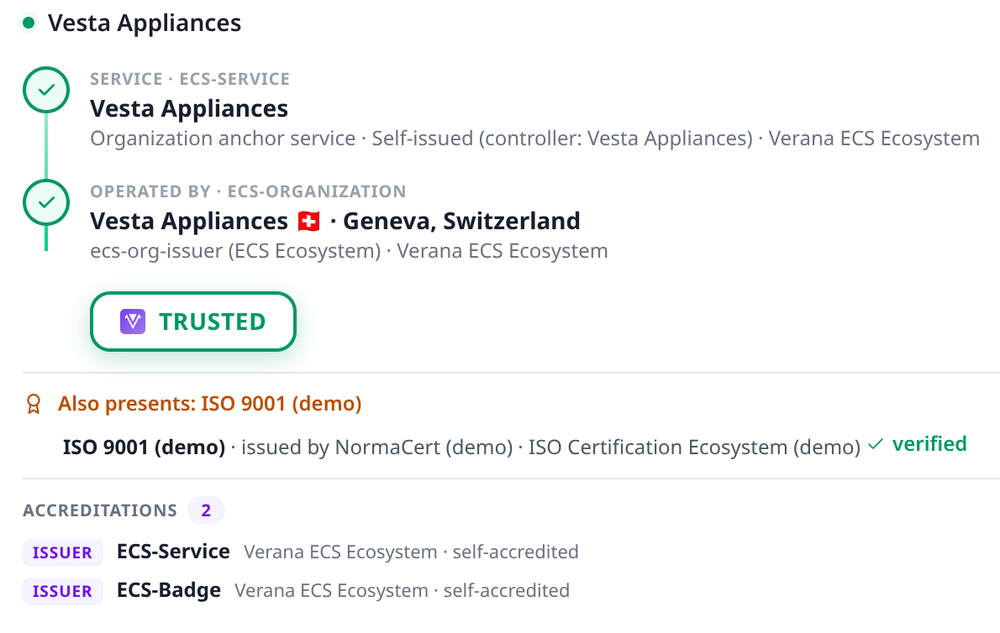
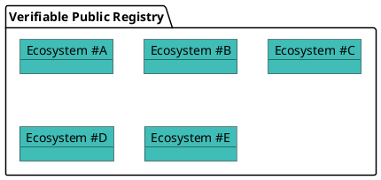
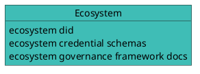
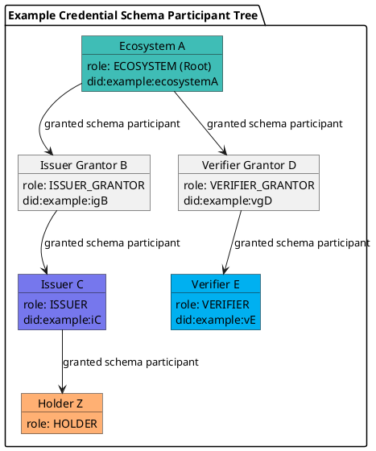
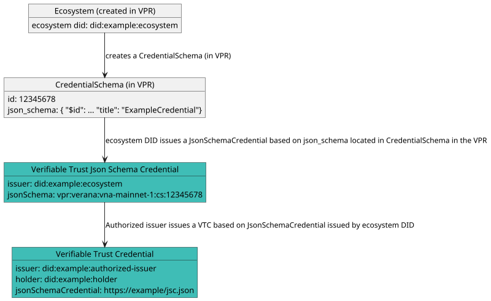
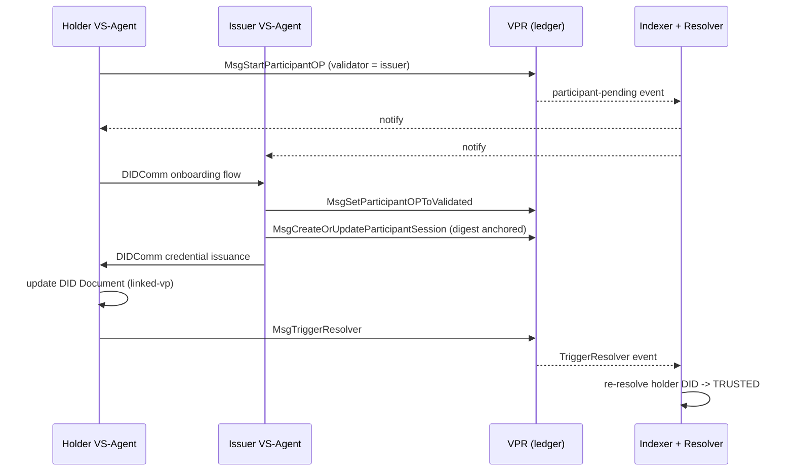
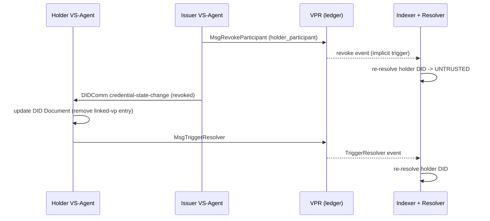

# Verifiable Trust v5 Specification

**Latest draft:** [spec v5-draft2](https://verana-labs.github.io/verifiable-trust-spec/)

**Latest stable:** [spec v4](https://verana-labs.github.io/verifiable-trust-spec/versions/v4/)

**Previous versions:** [spec v3](https://verana-labs.github.io/verifiable-trust-spec/versions/v3/)

**Editors:**

~ [Fabrice Rochette](https://www.linkedin.com/in/fabricerochette), ([The Verana Foundation](https://veranafoundation.org))

**Contributors:**

~ [Ariel Gentile](https://www.linkedin.com/in/aogentile/), ([The Verana Foundation](https://veranafoundation.org))
~ [Andres Vallecilla](https://www.linkedin.com/in/andres-felipe-vallecilla-puentes/), ([Mobiera](https://mobiera.com))
~ [Maxime Mansiet](https://www.linkedin.com/in/maxime-mansiet/), ([The Verana Foundation](https://veranafoundation.org))

**Participate:**

~ [GitHub repo](https://github.com/verana-labs/verifiable-trust-spec)

~ [File a bug](https://github.com/verana-labs/verifiable-trust-spec/issues)

~ [Commit history](https://github.com/verana-labs/verifiable-trust-spec/commits/main)

---

## Abstract

Today's internet has no built-in trust layer. Users cannot verify who operates a service before connecting to it, and service providers have no standardized way to confirm the identity of their users. The result is an environment where phishing, impersonation, spam, and credential theft thrive — not because of missing technology, but because of a missing trust architecture.

Current approaches make the problem worse. Passwords are fragile and reused. Federated login concentrates control in a handful of platforms. Each service imposes its own registration flow, fragmenting the user experience while centralizing personal data in siloed systems that are routinely breached. Privacy is an afterthought, and users have little visibility into who they are really interacting with.

The rapid expansion of AI agents makes this even more urgent. Autonomous agents now interact with services, make requests, and act on behalf of users or organizations — yet there is no trust layer for them to prove who they represent, what they are authorized to do, or whether their claims are legitimate. Without verifiable identity and authorization, AI agents become a new vector for fraud, impersonation, and unauthorized access at machine speed and scale.

**Verifiable Trust** is an open, decentralized trust layer designed to address these problems at their root. It introduces a model where every service, organization, and user agent can cryptographically prove its identity, authorization, and governance context — before any connection is established.

The core idea is straightforward: a **Verifiable Service** presents verifiable credentials that identify its operator, describe its purpose, and prove its authorization within a governed ecosystem. A **Verifiable User Agent** resolves and verifies these credentials, queries a **Verifiable Public Registry** to confirm that they were issued by recognized authorities, and displays a **Proof-of-Trust** to the user — all before the first interaction takes place.

A key consequence is that a Verifiable Service is not identified by an opaque URL, but by a **resolvable DID**. Its DID Document declares one or more service endpoints — at minimum a **DIDComm** channel used to establish trust and to bootstrap access to the rest of the service, and optionally additional endpoints such as **MCP**, **A2A**, or a plain **website**. A peer resolves the DID, performs trust resolution, and opens a DIDComm session over which it obtains any credentials or access tokens it needs; only then does it consume the other declared endpoints. This inverts the familiar "connect first, verify later" pattern of today's internet into a "verify first, then connect" model that applies uniformly to humans, applications, and AI agents.

This enables mutual authentication without passwords, verifiable service discovery without centralized directories, privacy-preserving credential exchange with selective disclosure and unlinkability, and ecosystem governance that is transparent, auditable, and decentralized.

Verifiable Trust is container-agnostic, supporting W3C Verifiable Credentials, Anonymous Credentials, SD-JWT Verifiable Credentials and ISO mdoc documents to balance transparency with privacy depending on the use case. It is also DID-method-agnostic, allowing ecosystems to operate across different decentralized identifier infrastructures.

This specification defines the Verifiable Trust architecture, its core concepts — Verifiable Services, Verifiable User Agents, Verifiable Trust Credentials, Essential Credential Schemas, and the trust resolution process — and the normative requirements for interoperable implementations.

## About this Document

In order to fully understand the concepts developed in this document, you should have some basic knowledge of the [ToIP stack](https://www.trustoverip.org/toip-model/), [[ref:DID]], [[ref:DIDComm]], [[ref: ecosystem]], and more generally, all terms present in the [Terminology](#terminology) section.

## Conformance

As well as sections marked as non-normative, all authoring guidelines, diagrams, examples, and notes in this specification are non-normative. Everything else in this specification is normative.
The key words MAY, MUST, MUST NOT, OPTIONAL, RECOMMENDED, REQUIRED, SHOULD, and SHOULD NOT in this document are to be interpreted as described in [BCP 14](https://datatracker.ietf.org/doc/html/bcp14) [RFC2119](https://w3c.github.io/vc-data-model/#bib-rfc2119) [RFC8174](https://w3c.github.io/vc-data-model/#bib-rfc8174) when, and only when, they appear in all capitals, as shown here.

## Terminology

[[def: credential schema, credential schemas]]:
~ An [[ref: VPR]] resource which represents a verifiable credential definition and the associated participants and business rules for issuing, verifying or holding a credential linked to this credential schema.

[[def: decentralized identifier, DID, DIDs]]:
~ A decentralized identifier, as specified in [[spec-norm:DID-CORE]].

[[def: verifiable identifier, VID, VIDs]]:
~ A digital identifier bound to cryptographic key material, such that another party can verify control of the identifier and resolve it to keys and endpoints, as specified in the [Trust Spanning Protocol (TSP) Specification](https://trustoverip.github.io/tswg-tsp-specification/). [[ref: DIDs]] are one type of VID. A [[ref: VPR]] registers VIDs without resolving them ([[ref: verifiable service entry]]); this specification requires the VIDs it resolves to be [[ref: DIDs]].

[[def: verifiable service entry, verifiable service entries]]:
~ The registration of a [[ref: VID]] in a [[ref: VPR]] (a `VerifiableService` entry, referenced by `vs_id`): it records the owner [[ref: corporation]], the agent account that operates the service, and the current value of the identifier; former values and their transition windows are known from the VPR's rotation events. Every `Participant` entry of a service references it, and a service MAY be registered without holding any `Participant` entry. See the [VPR spec](https://verana-labs.github.io/verifiable-trust-vpr-spec/#verifiableservice).

[[def: decentralized identifier communication, DIDComm]]:
~ [DIDComm](https://identity.foundation/didcomm-messaging/spec/) uses [[ref: DIDs]] to establish confidential, ongoing connections.

[[def: decentralized identifier document, DID Document, DID Documents]]:
~ A DID Document, as specified in [[spec-norm:DID-CORE]].

[[def: verifiable public registry, VPR, VPRs]]:
~ a public, normally decentralized network, which provides: ecosystem features, that can be used by all its [[ref: participants]]: create ecosystems, for each ecosystem, define its credential schemas, who can issue, verify credential of a specific credential schema,... For more information, please refer to [VPR Spec](https://verana-labs.github.io/verifiable-trust-vpr-spec/).

[[def: verifiable service, VS, VSs]]:
~ A service, identified by a resolvable [[ref: DID]], that can be deployed anywhere by its owner, that conforms to this spec, and that has a resolvable [[ref: proof of trust]]. A VS declares its service endpoints in its [[ref: DID Document]] (see [VS-SVC]); it MUST declare at least a [[ref: DIDComm]] endpoint and MAY declare additional services such as MCP, A2A, a website, or any other service type.

[[def: verifiable user agent, VUA, VUAs]]:
~ A user agent for accessing and using [[ref: VSs]]. To be considered a [[ref: VUA]], a user agent must conform and enforce this spec, such as presenting a proof of trust to end user before accepting connecting to [[ref: VS]] compliant services, and refuse connecting to not compliant services.

[[def: essential credential schema, essential credential schemas]]:
~ Default [[ref: credential schema]], owned by an [[ref: ecosystem]], that provide the basis for a trust layer to exist in the ecosystem so that [[ref: VUA]] can generate a [[ref: proof of trust]].

[[def: holder, holders]]:
~ A role an entity might perform by possessing one or more verifiable credentials and generating verifiable presentations from them. A holder is often, but not always, a [[ref: subject]] of the verifiable credentials they are holding. Holders store their credentials in credential repositories. Example holders include organizations, persons, things.

[[def: issuer, issuers]]:
~ A role an entity can perform by asserting claims about one or more [[ref: subjects]], creating a verifiable credential from these claims, and transmitting the verifiable credential to a [[ref: holder]]. Example issuers include corporations, non-profit organizations, trade associations, governments, and individuals.

[[def: linked-vp]]:
~ A presentation of a [[ref: verifiable credential]] as specified in [LINKED-VP](https://identity.foundation/linked-vp/).

[[def: proof of trust]]:
~ Visual representation using [[ref: essential credential schemas]] of a [[ref: trust resolution]] process of a [[ref: Verifiable Service]], for identifying the [[ref: VS]], its owner, and the [[ref: issuer]] of the verifiable credential of its owner.

[[def: session]]:
~ A session defines a connection to a DID Document provided service from a third party VS or VUA.

[[def: subject, subjects]]:
~ A thing about which claims are made. Example subjects include human beings, animals, things, and organization, a [[ref: DID]]...

[[def: ecosystem, ecosystems]]:
~ A [[ref: VPR]] resource, controlled by a [[ref: corporation]], that defines an approved list of [[ref: participants]] (issuers, verifiers, grantors, holders) authorized to issue, verify or hold credentials for a given set of credential schemas. The Ecosystem entry plays the role formerly known as "trust registry". For the canonical data model, see [Ecosystem](https://verana-labs.github.io/verifiable-trust-vpr-spec/#ecosystem) in the VPR spec.

[[def: corporation, corporations]]:
~ A [[ref: VPR]] resource representing a legal/organizational entity that controls one or more [[ref: ecosystems]] and/or holds one or more [[ref: participants]] in ecosystems. See [Corporation](https://verana-labs.github.io/verifiable-trust-vpr-spec/#corporation) in the VPR spec.

[[def: participant, participants]]:
~ A [[ref: VPR]] resource, linked to a [[ref: credential schema]] in an [[ref: ecosystem]], that records the role (ISSUER, VERIFIER, ISSUER_GRANTOR, VERIFIER_GRANTOR, ECOSYSTEM, HOLDER) granted to a [[ref: corporation]] for that schema. The Participant entry replaces what earlier drafts called a "Permission". See [Participant](https://verana-labs.github.io/verifiable-trust-vpr-spec/#participant) in the VPR spec.

[[def: trust resolution]]:
~ Process run by, for example a [[ref: VUA]] or a [[ref: VS]], which purpose is to recursively resolve [[ref: DID]] by digging into [[ref: DID Documents]] and look for [[ref: linked-vp]] entries and their [[ref: issuer]] [[ref: DIDs]], and [[ref: ecosystem]] entries to gather whether the service provided by the [[ref: DID]] is trustable (and legitimate), or not.

[[def: verifier, verifiers]]:
~ A role an entity performs by receiving one or more verifiable credentials, optionally inside a verifiable presentation for processing. Example verifiers include service providers.

[[def: verifiable credential, verifiable credentials]]:
~ A verifiable credential as defined in [[spec-norm:VC-DATA-MODEL]].

## Understanding Verifiable Trust

*This section is non-normative.*

When a user is invited to connect to a service, a verifiable trust-compliant user agent performs *trust resolution* on the service, presents the resulting Proof-of-Trust to the user, and prompts them to either accept or refuse the connection.



Trust Resolution is as simple as calling a method passing the DID of the service we want to resolve, to display a **Proof-of-Trust** to the end-user:

```json
resolve_trust("did:example:gaia")
```

and receive a response similar to this one:

```json
{
  "did":"did:example:gaia",
  "verified": true,
  "service_provider": {
      "id": "did:example:def",
      "type": "Organization",
      "name": "Gaia Registry LLC",
      "country": "zz",
      "reputation": {
        "issuedCredentials": 1234,
        "verifiedCredentials": 7678,
        "trustDepositValue": 176327.124356,
        "amountSlashed": 0,
        "stars": 5.0
      },
      "issuer": "did:example:zzz",
      ...
  },
  "service": {
      "name": "Gaia Registry",
      "termsAndConditionsUri": "http://example.com",
      "privacyPolicyUri": "http://example.com",
      "minimumAgeRequired": 16,
      "description": "Create your Metaverse ID at Gaia Registry! Protect your identity with biometrics and easily recover it if you loose your phone. Use your Gaia Identity to connect to fancy services with no password."
      ...
  },
  "credentials" : [
    {
      "type": "TrademarkCredential",
      ...
    }
  ]
  ...
}
```

Let's explain how the Verifiable Trust does it.

The core idea behind Verifiable Trust is simple: trust should not be implicit, but it should be verifiable, transparent, and decentralized.

A Verifiable Service (VS) presents several Verifiable Credentials to prove:

- Who operates the service, using an Essential Credential Schema (ECS) Organization or Persona Verifiable Trust Credential
- What the service offers, using an ECS Service Verifiable Trust Credential
- Trademark information, using a Trademark Verifiable Trust Credential

Additionally, the Verifiable Service presents computed reputation information. While this reputation data may support trust decisions, it is not directly defined by this specification. Refer to the [VPR Spec](https://verana-labs.github.io/verifiable-trust-vpr-spec/) for more information.

Verifiable Trust introduces the following core concepts:

- Verifiable Service (VS)
- Verifiable User Agent (VUA)
- Verifiable Public Registry (VPR)
- Verifiable Trust Credentials (VTC)
- Essential Credential Schemas (ECS)

The Proof-of-Trust is established by recursively resolving the credentials presented by (in this example) a service. What makes this trust verifiable is the use of cryptographic mechanisms built into Decentralized Identifiers (DIDs) and Verifiable Credentials, as applied across these five key concepts.

Because these concepts are deeply interdependent, you may need to explore them together, and revisit them several times to fully grasp the Verifiable Trust model.

### What is a Verifiable Service (VS)?

*This section is non-normative.*

A Verifiable Service (VS) is a service capable of identifying itself to a peer before any connection is established.

Peers wishing to connect to a VS can review the Verifiable Credentials presented by the service, verify their legitimacy through trust resolution, and decide whether to proceed with the connection based on the outcome.

A VS is also required to verify the trustworthiness of peers attempting to connect to it, whether those peers are other Verifiable Services (VS) or Verifiable User Agents (VUA), and must reject connections from non-verifiable peers.

Furthermore, if a Verifiable Service wants to issue credentials or request credential presentation, it must first prove that it is authorized to perform these actions. Otherwise, the peer must refuse the request.

#### Service Declaration

*This section is non-normative.*

A fundamental principle of Verifiable Trust is that **services are identified by DIDs, not by URLs**. Instead of a consumer pointing its client at an opaque endpoint — where neither the identity of the operator nor the legitimacy of the service can be verified — the consumer starts with a resolvable **DID** and discovers everything it needs from the corresponding **DID Document**.

The DID Document of a Verifiable Service declares two complementary things:

- **Identity material**, in the form of Linked Verifiable Presentations, used to prove who operates the service and under which ecosystem governance (see [VS-REQ]).
- **Service endpoints**, expressed as standard [DID Core `service` entries](https://www.w3.org/TR/did-core/#services), used to actually consume the service.

Every Verifiable Service MUST declare at least a **DIDComm** service endpoint. DIDComm plays a very specific role in the Verifiable Trust architecture: it is the **bootstrapping channel** of the service. Over DIDComm, a peer:

- completes mutual identity proof and trust resolution;
- negotiates higher-level protocols such as credential issuance, credential presentation, and secure messaging; and
- obtains whatever credentials, access tokens, or session artifacts are required to authenticate its later calls to the *other* declared endpoints.

In addition to DIDComm, a Verifiable Service MAY declare any number of other service endpoints, for example:

- an **MCP** endpoint exposing tools consumable by AI agents;
- an **A2A** endpoint for agent-to-agent interoperability;
- a **website** endpoint pointing to a traditional HTTP(S) resource;
- any other protocol type defined by the ecosystem.

These non-DIDComm endpoints form the **data plane** of the service; DIDComm is the **control plane** that authenticates access to them.

Regardless of the protocol used, the interaction flow is always the same:

1. A peer obtains the service's **DID** (via a link, QR code, directory, or any other means).
2. The peer **resolves** the DID and fetches its DID Document.
3. The peer performs **trust resolution**: it verifies the Linked Verifiable Presentations, checks issuer authorization in the VPR, and recursively resolves the DIDs of the service's operator and credential issuers.
4. Once trust is established, the peer opens a **DIDComm session** with the service. This session is the bootstrap channel: it is used to exchange further credentials, issue access tokens, or otherwise negotiate whatever authentication material is needed to reach the other declared endpoints.
5. Armed with the artifacts obtained over DIDComm, the peer finally **consumes** the non-DIDComm endpoint it is interested in (MCP, A2A, website, …), presenting the obtained tokens or credentials as required by that endpoint's protocol.

Because service endpoints are declared inside a cryptographically controlled DID Document, because the DID itself has been trust-resolved, and because the authentication material for non-DIDComm endpoints originates from the verified DIDComm handshake, any URL reached via those endpoints inherits the trust context of the DID. An MCP call, an A2A message, or a plain website fetch performed through a service entry declared in a verified DID Document is, by construction, an interaction with an identified and accountable operator — not with an anonymous server behind a random URL.

This reverses the common "connect first, verify later" model of today's internet into a "verify first, then connect" model. The normative requirements for Service Declaration are defined in [VS-SVC].

### What is a Verifiable User Agent (VUA)?

*This section is non-normative.*

A Verifiable User Agent (VUA) is software, such as a browser, app, or wallet, designed to connect with Verifiable Services (VS) and other VUAs. When establishing connections, a VUA must verify the identity and trustworthiness of its peers and allow connections only to compliant VS or VUA peers.

As part of this process, the VUA must perform trust resolution by:

- Verifying the Verifiable Credentials presented by the peers
- Querying Verifiable Public Registries (VPRs) to confirm that these credentials were issued by recognized and authorized issuers.

This ensures that all connections are based on verifiable trust, not assumptions.

### What is a Verifiable Public Registry (VPR)?

:::note
There is a [separated VPR spec](https://verana-labs.github.io/verifiable-trust-vpr-spec/). The following summarizes the main features of a VPR.
:::

*This section is non-normative.*

A **Verifiable Public Registry (VPR)** is a **“registry of registries”**, a public service that provides foundational infrastructure for decentralized trust ecosystems. It offers:

- **Ecosystem Management**:  
  [[ref: Corporations]] can create and manage their own [[ref: Ecosystems]], each with:
  - Defined **Credential Schemas**
  - Assigned roles for **Issuers**, **Verifiers**, and **Grantors** (Ecosystem Operators), modeled as `Participant` entries
  - Custom **business models** and onboarding policies

- **Query API for Trust Resolution**:  
  A standardized API used by **Verifiable Services (VSs)** and **Verifiable User Agents (VUAs)** to perform trust resolution, enabling them to query registry data and validate roles and `Participant` entries in real time. Query API must include support for the [TRQP](https://trustoverip.github.io/tswg-trust-registry-protocol/).



#### Ecosystems

*This section is non-normative.*

Each [[ref: Ecosystem]] must provide, at a minimum:

- a **resolvable DID** controlled by the [[ref: corporation]] that controls the ecosystem
- One or more **Governance Framework** document(s) (EGF)
- Zero or more **Credential Schemas**

The **Verifiable Public Registry (VPR)** is agnostic to the specific **DID methods** used. Trust resolution is performed externally, outside the VPR, allowing flexibility and interoperability across ecosystems.



#### Credential Schemas

*This section is non-normative.*

**Credential Schemas** are created and managed by [[ref: Ecosystems]] (which are themselves controlled by [[ref: corporations]]). Each Credential Schema includes, at a minimum:

- A **JSON Schema** that defines the structure of the corresponding **Verifiable Credential**
- An **IssuerOnboardingMode** for **issuance policy**, which determines how `ISSUER` `Participant` entries are created. Modes include:
  - `OPEN`: any [[ref: corporation]] issues under the [[ref: verifiable service entry]] of its service, without any `ISSUER` entry; the deposit of its participation, created by the first trust units minted on its payments, is what the ecosystem can slash; it MAY self-create an entry to declare the fees it charges.
  - `ECOSYSTEM_ONBOARDING_PROCESS`: `ISSUER` `Participant` entries are created directly by the controlling [[ref: ecosystem]] through an onboarding process.
  - `GRANTOR_ONBOARDING_PROCESS`: `ISSUER` `Participant` entries are created by one or several `Issuer Grantor(s)` (ecosystem operators responsible for onboarding issuers for the schema), selected by the [[ref: ecosystem]] through an onboarding process.
- A **VerifierOnboardingMode** for **verification policy**, which determines how `VERIFIER` `Participant` entries are created. Modes include:
  - `OPEN`: any [[ref: corporation]] verifies under the [[ref: verifiable service entry]] of its service, without any `VERIFIER` entry; the deposit of its participation, created by the first trust units minted on its payments, is what the ecosystem can slash.
  - `CREDENTIAL`: any service whose DID is the subject of a valid credential of one of the schemas listed in the schema's `verifier_credential_schema_ids` (all of them `PUBLIC` service schemas) verifies under the [[ref: verifiable service entry]] of its service, without any `VERIFIER` entry; the holder establishes the verifier's credential from its DID Document ([PRT-3]).
  - `ECOSYSTEM_ONBOARDING_PROCESS`: `VERIFIER` `Participant` entries are created directly by the controlling [[ref: ecosystem]] through an onboarding process.
  - `GRANTOR_ONBOARDING_PROCESS`: `VERIFIER` `Participant` entries are created by one or several `Verifier Grantor(s)` (ecosystem operators responsible for onboarding verifiers for the schema), selected by the [[ref: ecosystem]] through an onboarding process.
- A **HolderOnboardingMode** for **holder policy**, which determines how `HOLDER` `Participant` entries are created. Modes include:
  - `ISSUER_ONBOARDING_PROCESS`: `HOLDER` `Participant` entries are created for holders through an onboarding process that the issuer validates.
  - `PERMISSIONLESS`: a holder that wants to obtain credentials from an issuer does not require a `Participant` entry in the VPR.
- A **declaration** of what the credentials are for: `subject_kind`, `presentation_mode`, `credential_format`, `verification_session`, `presentation_validity_period`, `credential_anchoring` and `credential_revocation` ([VT-DECL]).
- A **Participant Tree** that defines the roles and relationships involved in managing the schema’s lifecycle.



Participant roles are defined in the table below:

| **Participant Role**   | **Description**                                                  |
|-----------------------|------------------------------------------------------------------|
| **Ecosystem**    | Create and control Ecosystems and Credential Schemas. Recognize other corporations by creating `Participant` entries for them.        |
| **Issuer Grantor**    | Ecosystem operator that creates Issuer `Participant` entries for candidate issuers.                   |
| **Verifier Grantor**  | Ecosystem operator that creates Verifier `Participant` entries for candidate verifiers.               |
| **Issuer**            | Can issue credentials of this schema.                            |
| **Verifier**          | Can request presentation of credentials of this schema.          |
| **Holder**            | Holds a credential.   |

Example of a Json Schema credential schema:

```json
{
  "$id": "vpr:verana:VPR_CHAIN_ID:cs:VPR_CREDENTIAL_SCHEMA_ID",
  "$schema": "https://json-schema.org/draft/2020-12/schema",
  "title": "ExampleCredential",
  "description": "ExampleCredential using JsonSchema",
  "type": "object",
  "properties": {
    "credentialSubject": {
      "type": "object",
      "properties": {
        "id": {
          "type": "string",
          "format": "uri"
        },
        "firstName": {
          "type": "string",
          "minLength": 0,
          "maxLength": 256
        },
        "lastName": {
          "type": "string",
          "minLength": 1,
          "maxLength": 256
        },
        "countryOfResidence": {
          "type": "string",
          "minLength": 2,
          "maxLength": 2
        }
      },
      "required": [
        "id",
        "lastName",
        "countryOfResidence"
      ]
    }
  }
}
```

### Verifiable Trust Json Schema Credentials (VTJSCs) and Verifiable Trust Credentials (VTCs)

Data stored in a VPR is not verified at the time of storage, nor does it need to be. Verification happens outside the scope of the VPR.

This is not a limitation, it’s a feature. For example, any DID method can be used, and the VPR will never attempt to resolve or validate DIDs itself.

The VPR provides registrations, not validations, leaving trust decisions and verification where they belong: **with the relying parties**.

To make things verifiable, for a given credential schema:

- Ecosystem creates a Credential Json Schema in a VPR, linked to its Ecosystem DID.
- Ecosystem issues, with its DID, a **Json Schema Credential** linked to its credential **Json Schema** in the VPR
- Then, authorized issuers can issue **Verifiable Trust Credentials** linked to the **Json Schema Credential** issued by Ecosystem DID.



### Essential Credential Schemas

Finally, the last concept: to enable fundamental trust operations, such as identifying service providers, service names, and related entities, we define a set of **Essential Credential Schemas (ECS)** specifically designed for these purposes:

- Service: describes **services**;
- Organization: identifies **organizations**, used to identify owner of a Service;
- Persona: identifies **individuals** used to identify owner of a Service;
- User Agent: describes **user agents**, such as browsers, mobile apps, and similar software;
- Badge: identifies **humans**, such as the employees or members of the organization that operates a Service.

With the Verifiable Trust concept now clearly established, we’re ready to dive into the specifications.

## Specification

### [VT-JSON-SCHEMA-CRED-W3C] Verifiable Trust Json Schema Credential

To provide cryptographic evidence that data stored in a VPR (e.g., a credential JSON Schema) is authored and controlled by the Ecosystem that governs it, the **[[ref: corporation]] controlling the Ecosystem** issues a VTJSC (which is a [JSON Schema Credential](https://www.w3.org/TR/vc-json-schema/)) **after** creating the `CredentialSchema` entry in the VPR.

The Json Schema Credential MUST be issued using the **Ecosystem DID recorded in the VPR** and MUST reference the corresponding `CredentialSchema` entry.

A VTJSC MUST include, at a minimum, the following attributes:

- `@context`: MUST include `https://www.w3.org/ns/credentials/v2`
- `id`: URL of the credential (e.g., a `https://example/vtjsc.json`)
- `type`: MUST include `VerifiableCredential`, `JsonSchemaCredential` and `VerifiableTrustJsonSchemaCredential`
- `issuer`: the Ecosystem DID
- `credentialSchema`: an object containing:
  - `id`: `https://www.w3.org/ns/credentials/json-schema/v2.json`
  - `type`: `JsonSchema`
  - `digestSRI`: sha384-S57yQDg1MTzF56Oi9DbSQ14u7jBy0RDdx0YbeV7shwhCS88G8SCXeFq82PafhCrW
- `credentialSubject`: an object containing:
  - `id`: the identifier of the `CredentialSchema` entry in the VPR
  - `type`: `JsonSchema`
  - `jsonSchema.$ref`: a reference to the JSON Schema stored in the VPR
  - `digestSRI`: a Subresource Integrity digest of the referenced JSON Schema
- a valid cryptographic proof, as defined by the Verifiable Credentials specification

::: note
[vc-json-schema](https://www.w3.org/TR/vc-json-schema/#jsonschemacredential) defines the `credentialSchema` attribute content. It MUST be exactly as specified in [vc-json-schema](https://www.w3.org/TR/vc-json-schema/#jsonschemacredential).
:::
This credential provides verifiable evidence of:

- **Control of the Ecosystem DID** (because it is the issuer of the credential)
- **Authenticity of the CredentialSchema declaration** (because the credential binds the Ecosystem DID to the VPR `CredentialSchema` entry)

```json
{
  "@context": [
    "https://www.w3.org/ns/credentials/v2"
  ],
  "id": "https://example/vtjsc.json",
  "type": ["VerifiableCredential", "JsonSchemaCredential", "VerifiableTrustJsonSchemaCredential"],
  "issuer": "did:example:ecosystem",

  "credentialSchema": {
    "id": "https://www.w3.org/ns/credentials/json-schema/v2.json",
    "type": "JsonSchema",
    "digestSRI": "sha384-S57yQDg1MTzF56Oi9DbSQ14u7jBy0RDdx0YbeV7shwhCS88G8SCXeFq82PafhCrW"
  },

  "credentialSubject": {
    "id": "vpr:verana:vna-mainnet-1:cs:12345678",
    "type": "JsonSchema",
    "jsonSchema": {
      "$ref": "vpr:verana:vna-mainnet-1:cs:12345678"
    },
    "digestSRI": "sha384-ABCSGyugst67rs67rdbugsy0RDdx0YbeV7shwhCS88G8SCXeFq82PafhCeZ"
  }
}
```

### [VT-ECOSYSTEM-DIDDOC] Ecosystem DID Document

Finally, the Ecosystem MUST publish each **VTJSC** as a **Linked Verifiable Presentation** in the **DID Document** associated with the **Ecosystem DID** registered in the VPR.

Publishing VTJSC in the Ecosystem DID Document ensures that:

- Credential Schemas defined in the VPR are **publicly discoverable**
- The binding between a Credential Schema and its **controlling Ecosystem DID** is **cryptographically verifiable**
- Wallets, issuers, and verifiers can **resolve and validate schema trust roots** without relying on off-chain registries or implicit trust assumptions

The Ecosystem DID Document MUST include a `service` entry of type `LinkedVerifiablePresentation` that references a Verifiable Presentation containing one or more VTJSC issued by the Ecosystem DID.

Example:

```json
"service": [
    {
      "id": "did:example:ecosystem#vpr-schemas-example-vtjsc-vp",
      "type": "LinkedVerifiablePresentation",
      "serviceEndpoint": ["https://ecosystem/schemas-example-vtjsc-vp.json"]
    }
    ...
  ]
```

### [VT-CRED] Verifiable Trust Credential

Once an Ecosystem has:

- Created its **Credential Schemas** in the VPR
- Issued the corresponding **VTJSC** using the Ecosystem DID
- Published those VTJSC as **Linked Verifiable Presentations** in the Ecosystem DID Document

authorized issuers MAY issue Verifiable Credentials that conform to those schemas.

Verifiable Credentials that comply with the Verifiable Trust Specification are referred to as **Verifiable Trust Credentials (VTCs)**.

A Verifiable Trust Credential MUST be linked to the applicable **VTJSC** issued by the Ecosystem DID. For W3C VTCs ([VT-CRED-W3C]), this link is established directly via the `credentialSchema` property. For AnonCreds VTCs ([VT-CRED-ANON]), the link is indirect: the AnonCreds Credential Definition references the VTJSC via `relatedJsonSchemaCredentialId`. For SD-JWT VTCs ([VT-CRED-SDJWT]), the link is indirect as well: the credential's `vct` Type Metadata references the VTJSC via the same `relatedJsonSchemaCredentialId` property. For mdoc VTCs ([VT-CRED-MDOC]), the document carries the VTJSC reference itself, as the `relatedJsonSchemaCredentialId` element of its Verifiable Trust namespace. In all cases, this establishes a verifiable and discoverable trust chain between:

- the issued credential,
- the governing schema definition,
- and the Ecosystem under which the schema is defined.

During verification, wallets and verifiers can resolve the referenced VTJSC, verify its authenticity, and determine whether the issuing DID was authorized to issue credentials under that schema. For credentials of a schema whose `credential_anchoring` is `DIGEST` (W3C VTCs, and SD-JWT and mdoc VTCs when the ecosystem chooses it), authorization is checked at the objectively determined issuance time (see [VT-CRED-W3C], [VT-CRED-SDJWT], [VT-CRED-MDOC]). For credentials of a `NONE` schema (AnonCreds VTCs, SD-JWT and mdoc VTCs otherwise), authorization is checked at credential reception time and the issuer MUST still be authorized at evaluation ([TR-5]) (see [VT-CRED-ANON], [VT-CRED-SDJWT], [VT-CRED-MDOC] and [CIT]).

#### Issuance Time and Unlinkability Considerations

*This section is non-normative.*

Verifiable Trust Credentials are designed to support multiple credential container formats and proof systems in order to balance **auditability**, **interoperability**, and **privacy**. Two recurring challenges must be considered when issuing and presenting credentials: **proving issuance time** and **preventing linkability**.

##### Proving Issuance Time

*This section is non-normative.*

In decentralized systems, relying on issuer-asserted timestamps (such as `issuanceDate`) is insufficient, as such values can be forged or backdated by the issuer.

To address this, the Verifiable Trust architecture enables **objective issuance-time determination** for W3C VTCs, and for SD-JWT and mdoc VTCs when the schema anchors them ([VT-DECL-ANCHOR]), by anchoring a deterministic cryptographic digest of the credential in the VPR at issuance time. Verifiers can recompute this digest from the presented credential and use the corresponding VPR registration timestamp as the effective issuance time. Note that this mechanism does not apply to AnonCreds VTCs, where unlinkability takes precedence over objective issuance-time anchoring (see [VT-CRED-ANON]).

This approach is:

- Independent of issuer-declared metadata
- Resistant to backdating or timestamp forgery
- Compatible with W3C Verifiable Credentials v2.0 (which no longer mandates `issuanceDate`)

##### Proving Unlinkability

*This section is non-normative.*

Unlinkability aims to prevent a [[ref: verifier]] from correlating multiple presentations of the same credential or identifying that two credentials were issued to the same subject.

However, strong issuance-time anchoring (e.g., via a stable digest) inherently introduces a **linkability vector**, as the same digest can be recognized across multiple presentations.

For this reason, unlinkability requirements vary depending on the **intended visibility** of the credential:

- **Public credentials** (e.g., Service, Organization, Persona ECS credentials), which are published as Linked Verifiable Presentations in DID Documents, do not require unlinkability. These credentials favor transparency, auditability, and ecosystem discoverability.
- **Private credentials** (e.g., user-held attributes, User Agent ECS credentials, KYC, entitlements) often require strong unlinkability and correlation resistance.

#### Choosing the Appropriate Credential Container

*This section is non-normative.*

The Verifiable Trust Specification is **container-agnostic** and supports multiple credential formats to address different requirements:

- **W3C Verifiable Credentials (VC v2.0)**  
  Suitable for public or semi-public credentials where:
  - auditability and interoperability are primary concerns
  - issuance time must be objectively verifiable
  - unlinkability is not required

- **Anonymous Credentials (e.g., AnonCreds)**  
  Suitable for private credentials where:
  - selective disclosure is required
  - multiple presentations must not be linkable
  - issuer authorization is verified by the holder's wallet at credential reception time rather than anchored via stable identifiers

- **IETF SD-JWT VC (`dc+sd-jwt`)**  
  Suitable for private credentials exchanged over OpenID4VCI and OpenID4VP where:
  - selective disclosure is required (per-claim disclosures)
  - holder binding is required (`cnf`)
  - interoperability with OpenID4VC wallets is more important than unlinkability
  - issuer authorization is anchored by the credential's digest when the schema anchors it, and verified by the holder's wallet at reception otherwise ([VT-DECL-ANCHOR-1], [VT-DECL-ANCHOR-2])

  An SD-JWT VC does not provide unlinkability. Salted disclosures limit correlation. They do not remove it. Use AnonCreds when presentations must not be linkable.

- **ISO/IEC 18013-5 mdoc (`mso_mdoc`)**  
  Suitable for private credentials of natural persons presented over OpenID4VP or the Digital Credentials API where:
  - selective disclosure is required (per-element disclosure)
  - holder binding through a device key is required
  - compatibility with mobile-document wallets and readers is more important than unlinkability
  - revocation through a status list and batch issuance of single-use copies are acceptable ([VT-CRED-MDOC-7], [VT-CRED-MDOC-8])

  An mdoc does not provide unlinkability either: its issuer-signed part is a stable correlator, mitigated by issuing batches of copies.

Depending on the credential format and proof system used, ecosystems can achieve different trade-offs between:

- transparency vs. privacy
- auditability vs. unlinkability
- ecosystem governance vs. holder anonymity

#### Design Principle

The Verifiable Trust framework deliberately avoids mandating a single credential format. Instead, it defines **verifiable governance, authorization, and issuance-time semantics** that can be enforced across different credential technologies.

Ecosystems MUST clearly specify, for each credential schema, the expected credential container format and privacy properties in order to ensure consistent trust resolution and verifier behavior.

### [VT-CRED-W3C] W3C Verifiable Trust Credential (VTC)

A W3C Verifiable Trust Credential MUST include, at a minimum, the following attributes:

- `@context`: MUST include `https://www.w3.org/ns/credentials/v2`
- `id`: a globally unique identifier for the credential (e.g., a `urn:uuid:`)
- `type`: MUST include `VerifiableCredential` and `VerifiableTrustCredential`, and MAY include one or more schema-specific types
- `validFrom`: optional
- `validUntil`: optional
- `issuer`: the DID of the authorized issuer issuing the credential
- `credentialSubject`: an object containing:
  - `id`: the DID of the credential holder
  - all attributes required by the referenced Credential Schema
- `credentialSchema`: an object containing:
  - `id`: the identifier of the VTJSC issued by the Ecosystem DID
  - `type`: `JsonSchemaCredential`
- a valid cryptographic proof, as defined by the Verifiable Credentials specification

#### W3C VTC Example

```json
{
  "@context": [
    "https://www.w3.org/ns/credentials/v2"
  ],
  "id": "urn:uuid:7f3c9a2e-9c8e-4f6e-9c0b-1e3f2d8a91ab",
  "validFrom": "2010-01-01T19:23:24Z",
  "validUntil": "2020-01-01T19:23:24Z",
  "type": [
    "VerifiableCredential",
    "VerifiableTrustCredential",
    "ExampleCredential"
  ],
  "issuer": "did:example:authorized-issuer",
  "credentialSubject": {
    "id": "did:example:holder"
    // ... schema-defined attributes
  },
  "credentialSchema": {
    "id": "https://example/vtjsc.json",
    "type": "JsonSchemaCredential"
  }
}
```

In this example:

- credentialSchema.id references the JSON Schema Credential issued by the Ecosystem DID.
- The JSON Schema Credential itself is discoverable via a LinkedVerifiablePresentation in the Ecosystem DID Document.
- Authorization of the issuer is determined by evaluating VPR state (e.g., issuer `Participant` entries) at the issuance time evidenced by the credential’s anchored digest.

This design ensures that trust decisions remain fully verifiable, ecosystem-governed, and independent of centralized validation services.

#### W3C VTCs: Determining Credential Issuance Time

Verifiable Trust Credentials do not rely on an issuer-asserted `issuanceDate` field to establish the time of issuance.

Instead, the issuance time of a Verifiable Trust Credential is **objectively determined** using the credential’s cryptographic digest anchored in the VPR.

##### Computing `digestJCS`

The `digestJCS` of a W3C Verifiable Trust Credential MUST be computed as follows:

1. **Take the credential as issued, in its entirety.** No member is removed: `id` and `proof` are both included. Where the credential carries a proof set, the complete set as issued is included.

2. **Canonicalize** the credential using the [JSON Canonicalization Scheme (JCS)](https://www.rfc-editor.org/rfc/rfc8785) as defined in RFC 8785. Implementations MUST use an RFC 8785 conformant canonicalization; a serializer that merely sorts object keys is not equivalent and MUST NOT be substituted.

3. **Hash** the UTF-8 encoding of the canonical form, using the algorithm named by the `digest_algorithm` attribute of the `CredentialSchema` entry the credential refers to, resolved as defined in [Resolving the digest algorithm](#resolving-the-digest-algorithm). `digest_algorithm` MUST be one of the lowercase tokens `sha384` or `sha512`.

4. **Encode** the raw digest in standard base64 **with** padding, as defined in [RFC 4648 section 4](https://www.rfc-editor.org/rfc/rfc4648#section-4). The base64url alphabet of RFC 4648 section 5 MUST NOT be used. No algorithm prefix is added: the `digestJCS` is the encoded digest alone. A party interpreting a `digestJCS` determines the algorithm from the `digest_algorithm` of the governing `CredentialSchema`, resolved as above, and never from the value itself. Example: `GOp0dicJ4ufacOQxQfQojCyGoC7RJClOzqb23pJubmG2z3cqD/73j1+3kYNSrxUP`.

The resulting string is the credential's `digestJCS`: the value anchored in the VPR at issuance, and the value recomputed and looked up during verification.

##### Resolving the digest algorithm

`digest_algorithm` is an attribute of the `CredentialSchema` entry that governs the credential. To obtain it, an issuer or verifier MUST:

1. read the credential's `credentialSchema.id`, which is the URL of the VTJSC;
2. resolve the VTJSC and read its `credentialSubject.jsonSchema.$ref`, which is the VPR reference of the `CredentialSchema` entry;
3. resolve that reference and read the `digest_algorithm` attribute of the referenced [CredentialSchema](https://verana-labs.github.io/verifiable-trust-vpr-spec/#credentialschema) entry.

`digest_algorithm` is fixed when the `CredentialSchema` entry is created and MUST NOT change afterwards.

A credential whose schema is not registered in a VPR has no `CredentialSchema` entry, and therefore no `digest_algorithm`. Such a credential is not a Verifiable Trust Credential (see [VT-CRED]) and this section does not apply to it.

##### Anchoring the digest

When issuing a Verifiable Trust Credential, the issuer MUST compute its `digestJCS` as defined above, and **register** it in the VPR by calling [CreateOrUpdateParticipantSession](https://verana-labs.github.io/verifiable-trust-vpr-spec/#mod-pp-msg-10-create-or-update-participant-session) with the `digest` parameter; the issuance session transaction is sent even when no fees are due; its event anchors the digest with the block time, the issuer's verifiable service entry, the schema and the `ISSUER` entry referenced, if any; under `VPR` revocation ([VT-DECL-ANCHOR-4]) the VPR also stores it as a `Digest` entry, with the credential's `validUntil` given as `credential_valid_until`, until that expiry. Registration MUST succeed before the credential is delivered to the holder.

##### Verifying the issuance time

During verification, a trust resolution process MUST:

1. **Recompute** the `digestJCS` of the received credential, exactly as defined in [Computing `digestJCS`](#computing-digestjcs);
2. **Locate** its anchoring: the issuance session transaction that carried the digest, which indexers serve from its event (the VPR keeps no entry for it unless the schema's `credential_revocation` is `VPR`);
3. **Use** the block time of that transaction as the **effective issuance time** of the credential;
4. **Check** the anchoring: the transaction MUST have been signed for the [[ref: verifiable service entry]] whose identifier at that time was the credential's issuer DID ([TR-10]), with the credential's schema; the issuer MUST have held for that schema an `ISSUER` entry effective at that time (the entry [TR-5] and [TR-9] refer to) or, when the schema's `issuer_onboarding_mode` is `OPEN`, none is required. An anchoring by another corporation is not the issuer's and is disregarded; a digest stored directly with Store Digest is not an anchoring;
5. **Check**, when the schema's `credential_revocation` is `VPR`, the `Digest` entry: it MUST exist and its `revoked` MUST be null, or later than the evaluated time.

A credential whose recomputed `digestJCS` has no anchoring by its issuer in the VPR has no provable issuance time, and verification MUST fail. Under `VPR` revocation, a credential whose `Digest` entry is revoked has been revoked, by its issuer or by the ecosystem governance above it, as of `revoked`, and verification MUST fail at any evaluated time at or after it; a credential whose `Digest` entry is gone has passed its expiry, and fails on that expiry.

##### Issuance time security considerations

This mechanism binds a credential's content to a block timestamp assigned by the VPR, and so allows verification that the issuer was authorized to issue the credential **at that time** rather than merely at the time of presentation. Its guarantees, and their limits, are:

- An issuer **cannot backdate** a credential. The `created` timestamp is assigned at block execution and is not under the issuer's control.

- An issuer **cannot pre-date** one. The digest covers the credential's `proof`, so it cannot be computed before the credential is signed. Anchoring can only place `created` at or after actual issuance.

- **A digest anchored by another party is detected.** Any registered corporation MAY anchor any digest under one of its [[ref: verifiable service entries]], through an operator or the entry's vs-agent, and because [Store Digest](https://verana-labs.github.io/verifiable-trust-vpr-spec/#mod-di-msg-1-store-digest) is idempotent the first anchor fixes `created` and the anchoring entry, and so the owner, permanently. Computing the digest requires the signed credential, which exists nowhere outside the issuer until delivery, and registration MUST precede delivery. Should another party anchor first (a credential delivered or leaked before registration), the entry belongs to that party: under `VPR` revocation the issuer's issuance session aborts, since the VPR refuses a Credential Issuance whose digest is already owned by another corporation; under `NONE` revocation nothing is written and the stored digest is disregarded ([TR-4]), and if the credential were delivered anyway the holder refuses it at reception ([CIT-4]) and trust resolution rejects it ([TR-4]); the issuer re-issues. Ed25519 signatures are deterministic, so re-issuing the identical credential yields the identical digest: the re-issued credential MUST differ in content (for example a new `id`).

- A `Digest` entry records `digest`, `created`, the [[ref: verifiable service entry]] under which it was anchored (whose corporation owns the digest) and, for a credential, its schema (together they name the issuer's participation, whose deposit outlives its entries), an optional `revoked` timestamp and, for schemas whose `credential_revocation` is `VPR`, the credential's expiry, after which the entry is deleted; under `NONE` revocation no entry is written and the event of the issuance session is the anchoring. It does not record which operator account anchored it, and the VPR does not verify a digest against any content. Attribution of a credential to its issuer comes from the credential's own proof, verified separately per [TR-2].

- Re-signing a credential changes its digest. A credential re-signed after issuance (key rotation, proof-suite migration) MUST have its new digest registered, and its effective issuance time becomes that of the new registration. Issuers requiring a stable issuance time MUST NOT re-sign in place.

#### [VT-CRED-W3C-LINKED-VP] W3C VTC Linked VP

A DID Document MAY present an unlimited number of Verifiable Trust Credentials as Linked-VPs, for credentials of schemas whose `presentation_mode` is `PUBLIC` ([VT-DECL-MODE-1]); credentials of other schemas MUST NOT be published ([VT-DECL-MODE-2]); the VTJSCs published per [VT-ECOSYSTEM-DIDDOC] are not concerned. Linked-VPs MUST be signed by the DID controller of the DID Document, and MUST be declared with a fragment that starts with `#vpr-schemas-` and ends with `-vtc-vp`. Example:

```json
"service": [
    {
      "id": "did:example:ecosystem#vpr-schemas-example-vtc-vp",
      "type": "LinkedVerifiablePresentation",
      "serviceEndpoint": ["https://ecosystem/schemas-example-vtc-vp.json"]
    }
    ...
  ]
```

> The `example` component of the fragment identifier is an **arbitrary, controller-defined qualifier** and MAY be any value chosen by the DID controller to prevent fragment collisions within the same DID Document (e.g., a schema name, logical grouping, version label, or sequence identifier). It has no normative meaning beyond uniqueness within the DID Document.

### [VT-CRED-ANON] AnonCreds Verifiable Trust Credential (VTC)

An AnonCreds Verifiable Trust Credential is a Verifiable Trust Credential issued using the [AnonCreds](https://anoncreds.github.io/anoncreds-spec/) specification. AnonCreds credentials provide **zero-knowledge proof (ZKP)** capabilities that are essential for credentials requiring strong privacy guarantees.

An ecosystem declares the AnonCreds container in a schema's `credential_format` ([VT-DECL-FORMAT]) when it needs one or more of the following; SD-JWT VTCs ([VT-CRED-SDJWT]) offer selective disclosure but none of the other three:

- **Selective disclosure** is needed — the holder reveals only the requested attributes, not the full credential.
- **Unlinkability** is needed — multiple presentations of the same credential MUST NOT be linkable by verifiers or colluding parties.
- **Predicate proofs** are needed — the holder proves a boolean expression (e.g., `age >= 18`) without revealing the underlying claim value.
- **Holder correlation resistance** is needed — no correlatable identifier is shared during issuance or presentation.

::: note
Using AnonCreds for ECS User Agent VTCs is REQUIRED as specified in [VUA-REQ], and for ECS Badge VTCs as specified in [VT-ECS-CRED]. See also [VT-ECS-UA-CRED-ANON] and [VT-ECS-BADGE-CRED-ANON].
:::

#### AnonCreds VTC Setup

In the Verifiable Trust concept, AnonCreds VTCs do **not** require publishing a separate [AnonCreds Schema](https://anoncreds.github.io/anoncreds-spec/#schema-publisher-publish-schema-object) to a VDR. Instead, the credential schema is already defined by the [VT-JSON-SCHEMA-CRED-W3C] (VTJSC) issued by the Ecosystem DID, and the AnonCreds Credential Definition references it.

Before issuing AnonCreds VTCs, the following setup MUST be completed:

1. **Credential Definition**: The issuer MUST create and publish a [Credential Definition](https://anoncreds.github.io/anoncreds-spec/#issuer-create-and-publish-credential-definition-object). The Credential Definition contains the issuer's public keys used for signing credentials and is required by holders and verifiers for presentation generation and verification. The Credential Definition MUST include a `relatedJsonSchemaCredentialId` that references the VTJSC issued by the Ecosystem DID for the corresponding `CredentialSchema`. The `attributes` list MUST match the attributes defined in the referenced VTJSC.

2. **Revocation Registry** (optional): If credential revocation is needed, the issuer MUST create and publish a [Revocation Registry Definition](https://anoncreds.github.io/anoncreds-spec/#issuer-create-and-publish-revocation-registry-objects) and an initial Revocation Status List. When the issuer serves these objects itself (did:web AnonCreds method, did:webvh attested resources), they are published under the `AnonCredsRegistry` service of its DID Document ([VS-SVC-8]), through which their identifiers resolve; on a ledger method the VDR holds them. In both cases they carry the issuer DID as `issuerId`.

3. **Link Secret**: Each holder MUST create and store a [link secret](https://anoncreds.github.io/anoncreds-spec/#holder-create-and-store-link-secret), a private value that enables credential-to-holder binding across multiple credentials without revealing a correlatable identifier.

##### AnonCreds Credential Definition Example

```json
[
  {
    "id": "did:example:issuer/resources/creddef-123",
    "name": "gov-id",
    "version": "1.0",
    "attributes": [
      "birthDate",
      "documentNumber",
      "documentType",
      "firstName",
      "lastName",
      "nationality"
    ],
    "revocationSupported": false,
    "relatedJsonSchemaCredentialId": "https://example-ecosystem/vt/schemas-gov-id-jsc.json"
  }
]
```

In this example, `relatedJsonSchemaCredentialId` points to the VTJSC issued by the Ecosystem DID. This establishes the trust chain between the AnonCreds Credential Definition and the ecosystem-governed schema, without duplicating the schema definition in a separate AnonCreds-specific registry.

#### AnonCreds VTC Issuance

AnonCreds credential issuance follows the [AnonCreds Issuance Data Flow](https://anoncreds.github.io/anoncreds-spec/#anoncreds-issuance-data-flow):

1. The issuer sends a **Credential Offer** referencing the Credential Definition.
2. The holder evaluates the offer, retrieves the Credential Definition from the VDR or from the issuer's `AnonCredsRegistry` service ([VS-SVC-8]), and sends a **Credential Request** that includes a blinded commitment to the holder's link secret.
3. The issuer verifies the request and issues the credential with a **blind signature** over the credential attributes and the blinded link secret.
4. The holder unblinds the signature, verifies it, and stores the credential.

The issuer never learns the holder's link secret, and only the holder can unblind the final credential signature.

#### AnonCreds VTC Presentation

AnonCreds holders never present the raw signed credential to verifiers. Instead, the holder derives a **verifiable presentation** — a zero-knowledge proof that demonstrates:

- Knowledge of a valid credential signature from a specific issuer (identified by Credential Definition).
- The values of selectively disclosed attributes.
- The truth of requested predicate expressions over undisclosed integer attributes.
- That the credential has not been revoked (if applicable), without revealing a correlatable revocation identifier.
- That all source credentials in a multi-credential presentation are bound to the same link secret.

Presentations follow the [AnonCreds Presentation Data Flow](https://anoncreds.github.io/anoncreds-spec/#anoncreds-presentation-data-flow). Verifiers create a **Presentation Request** specifying requested attributes, predicates, and non-revocation intervals.

#### AnonCreds VTCs: Issuance Time

Unlike W3C VTCs, AnonCreds VTCs do **not** anchor a `digest` in the VPR to establish issuance time. Because AnonCreds presentations are derived zero-knowledge proofs — not the original credential — a verifier cannot independently recompute a digest from the presentation, making a VPR-anchored digest binding impractical without introducing correlation risks that conflict with AnonCreds' privacy goals. The VPR therefore requires `credential_anchoring` `NONE` for `ANONCREDS` schemas ([VT-DECL-ANCHOR-3]).

Issuer authorization checks at credential reception time are covered by [CIT].

#### AnonCreds VTC W3C Representation

AnonCreds credentials MAY be represented in the [W3C Verifiable Credentials format](https://anoncreds.github.io/anoncreds-spec/#w3c-verifiable-credentials-representation). In this representation:

- `@context` MUST include the AnonCreds W3C context
- `type` MUST include `VerifiableCredential` and `AnonCredsCredential`
- `credentialSchema` MUST reference the AnonCreds Credential Definition. The Credential Definition itself links back to the VTJSC via `relatedJsonSchemaCredentialId`.
- `proof` MUST include an `AnonCredsProof2023` entry

```json
{
  "@context": [
    "https://www.w3.org/2018/credentials/v1",
    "https://raw.githubusercontent.com/anoncreds/anoncreds-spec/main/data/anoncreds-w3c-context.json"
  ],
  "type": [
    "VerifiableCredential",
    "AnonCredsCredential"
  ],
  "issuer": "did:example:authorized-issuer",
  "credentialSchema": {
    "type": "AnonCredsDefinition",
    "definition": "did:example:authorized-issuer/resources/creddef-123"
  },
  "credentialSubject": {
    "userAgentType": "mobile-wallet"
  },
  "proof": {
    "type": "AnonCredsProof2023",
    "signature": "AAAgf9w5.....8Z_x3FqdwRHoWruiF0FlM"
  }
}
```

#### AnonCreds VTC Privacy Properties

AnonCreds VTCs provide the following privacy properties relevant to the Verifiable Trust framework:

- **No correlatable holder identifier**: The link secret is never revealed; presentations prove knowledge of it via ZKP.
- **Unlinkable presentations**: Each presentation generates unique proof values, preventing verifiers from linking multiple presentations of the same credential.
- **Selective disclosure**: Only requested attributes are revealed; unrequested attributes remain hidden.
- **Predicate proofs**: Integer attributes (e.g., dates, ages) can be proven via boolean expressions without revealing the actual values.
- **Non-revocation proofs**: Revocation status is proven without disclosing a correlatable credential index.
- **Multi-credential binding**: A holder can prove that multiple credentials were issued to the same entity (same link secret) without revealing the link secret itself.

### [VT-CRED-SDJWT] SD-JWT Verifiable Trust Credential (VTC)

An SD-JWT Verifiable Trust Credential is a Verifiable Trust Credential issued as an [IETF SD-JWT VC](https://datatracker.ietf.org/doc/html/draft-ietf-oauth-sd-jwt-vc-19) (`dc+sd-jwt`). SD-JWT VTCs provide **selective disclosure** through salted-hash disclosures and **holder binding** through the `cnf` claim, and are the natural container for OpenID4VCI issuance and OpenID4VP presentation flows.

SD-JWT VC Type Metadata defines no property for the **governance** of a type. The schema properties `schema` and `schema_uri` existed in earlier revisions and were removed in [draft-12](https://www.ietf.org/archive/id/draft-ietf-oauth-sd-jwt-vc-12.txt); the same revision introduced the extensibility rule that a Type Metadata document "MAY contain additional top level or subordinate properties" and that "Consumers MUST ignore properties that are not understood". Verifiable Trust uses that extension point to carry the link to the Ecosystem that governs the type.

- [VT-CRED-SDJWT-1] The `vct` of an SD-JWT VTC identifies the **type**, not the issuer. Every issuer that an [[ref: ecosystem]] accredits for a given `CredentialSchema` MUST use the same `vct` value, and that value MUST NOT change while the schema exists. The Type Metadata document it identifies is published by the Ecosystem that issued the VTJSC, not by each credential issuer, so a relying party can request a type without naming the issuers that may satisfy it.

- [VT-CRED-SDJWT-2] The `vct` of an SD-JWT VTC MUST be an `https` URL that resolves to that Type Metadata document. [SD-JWT VC](https://datatracker.ietf.org/doc/html/draft-ietf-oauth-sd-jwt-vc-19) permits any Collision-Resistant Name and leaves retrieval to the consumer's discretion; Verifiable Trust narrows this, so that a relying party reaches the governing Ecosystem from the credential alone, with no out-of-band configuration. A consequence of this narrowing is that the Ecosystem serving the document observes requests for it; relying parties SHOULD cache Type Metadata, as [SD-JWT VC](https://datatracker.ietf.org/doc/html/draft-ietf-oauth-sd-jwt-vc-19) recommends, and MUST NOT treat a cached document as less authoritative than a freshly retrieved one.

- [VT-CRED-SDJWT-3] The Type Metadata document MUST carry the property `relatedJsonSchemaCredentialId`, whose value identifies the **VTJSC** issued by the Ecosystem DID for the corresponding `CredentialSchema` — the same linkage property the AnonCreds Credential Definition uses ([VT-CRED-ANON]). The document MUST NOT carry `schema` or `schema_uri`. The JSON Schema MUST be obtained **through** the VTJSC, from its `credentialSubject.jsonSchema.$ref`, and verified against the VTJSC's `digestSRI`. Resolution of that `$ref` is performed through the relying party's own VPR access per [WL-VPR], so no single hosting endpoint is a point of failure and the schema's authenticity derives from the Ecosystem DID's signature rather than from transport.

- [VT-CRED-SDJWT-4] An SD-JWT VTC MUST carry `vct#integrity`, the integrity metadata of the Type Metadata document it names, as defined by [SD-JWT VC](https://datatracker.ietf.org/doc/html/draft-ietf-oauth-sd-jwt-vc-19). A relying party MUST verify it before using the document, and MUST fail verification when it does not match. Without this binding the link from the credential to its VTJSC rests on an unsigned document at a mutable URL; `vct#integrity` gives the SD-JWT container the same property that `credentialSchema` gives a W3C VTC ([VT-CRED-W3C]) and that the Credential Definition gives an AnonCreds VTC ([VT-CRED-ANON]).

- [VT-CRED-SDJWT-5] During trust resolution, the VTJSC referenced under [VT-CRED-SDJWT-3] MUST be verified per [TR-3], and the issuer MUST be verified as authorized per [TR-5]: at the effective issuance time given by the credential's digest when the schema's `credential_anchoring` is `DIGEST` ([TR-4]), as **currently authorized** when it is `NONE`. Issuer authorization at credential reception time is enforced by the holder's wallet as specified in [CIT].

- [VT-CRED-SDJWT-6] The relying party MUST determine the issuer [[ref: DID]] of an SD-JWT VTC as follows: when `iss` is a DID, that DID; otherwise, the DID carried as a URI SAN of the end-entity certificate of the `x5c` header. When neither yields a DID, verification MUST fail. The signing key MUST appear under `assertionMethod` in that DID's [[ref: DID Document]], and that DID MUST itself verify per [TR]. An X.509 certificate carrying the DID as a URI SAN conveys the key; the authority for that key is the DID Document.

- [VT-CRED-SDJWT-7] Revocation follows the schema's `credential_revocation` ([VT-DECL-ANCHOR-4]). Under `VPR`, the revocation of the credential's digest in the VPR is the revocation of the credential, consulted in every trust resolution ([TR-4]); a [Token Status List](https://datatracker.ietf.org/doc/html/draft-ietf-oauth-status-list-21) MAY additionally be referenced in the `status` claim, for suspension or for relying parties outside Verifiable Trust, and is never the only signal. Under `NONE` revocation, whatever the anchoring, an issuer that needs revocation MUST use a Token Status List, carry its reference in the `status` claim and keep the list available for the life of its credentials, and a relying party MUST evaluate that claim during trust resolution ([TR-11]). In both cases the base of the list MUST be declared in the issuer's DID Document as a `CredentialStatusList` service ([VS-SVC-8]) and the Status List Token MUST be signed by a key of the issuer DID ([VS-SVC-9]): the credential names the list, the DID Document vouches for the base, and the signature proves the issuer controls what the list says.

- [VT-CRED-SDJWT-8] An SD-JWT VTC is a **private credential**. It MUST NOT be published as a Linked Verifiable Presentation in a [[ref: DID Document]]. Public Verifiable Trust Credentials, including the Essential Credential Schemas that a [[ref: VS]] presents, use the W3C container ([VT-CRED-W3C]), whose effective issuance time [TR-4] determines.

#### SD-JWT VTCs: Digest and Issuance Time

The **digest of an SD-JWT VTC** is the hash, with the `digest_algorithm` of the schema, of the exact bytes of its issuer-signed JWT in compact serialization (header, payload and signature, without any disclosure or key-binding JWT). The issuer-signed JWT is transmitted unchanged in every presentation whatever claims the holder discloses, so the digest is computed once by the issuer before delivery and recomputed by any verifier from any presentation. The issuer-signed JWT is already a correlator across verifiers; anchoring its digest adds no linkability.

When the schema's `credential_anchoring` is `DIGEST`, the issuer MUST anchor that digest in the VPR through the issuance `ParticipantSession` before delivering the credential, exactly as [VT-CRED-W3C] requires for `digestJCS`; the event of the issuance session then gives the effective issuance time and the entry the credential was issued under, and, under `VPR` revocation, the `Digest` entry its revocation ([TR-4], [CIT-4], [VT-CRED-SDJWT-7]). When it is `NONE`, no digest is anchored, `iat` is an issuer-asserted value that a relying party MUST NOT treat as a proven issuance time, and the issuer MUST be currently authorized at evaluation time ([TR-5]).

Issuer authorization checks at credential reception time are covered by [CIT].

#### Example Type Metadata of an SD-JWT VTC

```json
{
  "vct": "https://ecosystem.example/vt/vct/42",
  "name": "ExampleCredential",
  "relatedJsonSchemaCredentialId": "https://ecosystem.example/vt/schemas-example-jsc.json",
  "display": [{ "locale": "en", "name": "ExampleCredential" }],
  "claims": [{ "path": ["firstName"] }, { "path": ["lastName"] }]
}
```

A relying party holding any SD-JWT VTC, credential offer, or presentation request can therefore walk `vct` → Type Metadata → VTJSC → Ecosystem, with every step verifiable, and query the VPR for the peer's authorization — without pre-configured knowledge of the credential type.

### [VT-CRED-MDOC] ISO mdoc Verifiable Trust Credential (VTC)

An mdoc Verifiable Trust Credential is a Verifiable Trust Credential issued as an [ISO/IEC 18013-5](https://www.iso.org/standard/69084.html) mobile document (`mso_mdoc`). An mdoc has two signed parts: the **issuer-signed** part, namespaces of salted data elements and `issuerAuth`, a COSE_Sign1 over the Mobile Security Object (MSO) that carries the `docType`, the digest of every element, the holder's device key, the validity window and, optionally, a status reference; and the **device-signed** part, `deviceAuth`, the holder's signature over the session transcript of the presentation. Selective disclosure works by omitting elements, holder binding by the device key, and the issuer is identified by the X.509 chain of `issuerAuth`. ISO defines no type metadata: a document is typed by its `docType` and its namespaces, in CBOR. This version of this specification defines mdoc VTCs for presentation over [OpenID4VP](https://openid.net/specs/openid-4-verifiable-presentations-1_0.html) and the Digital Credentials API only; no DIDComm presentation of an mdoc is defined.

- [VT-CRED-MDOC-1] The `docType` of an mdoc VTC identifies the **type**, not the issuer. Every issuer that an [[ref: ecosystem]] accredits for a given `CredentialSchema` MUST use the same `docType` value, chosen by the ecosystem (ISO recommends a reverse-domain name), and that value MUST NOT change while the schema exists, so that a relying party can request a type without naming the issuers that may satisfy it.

- [VT-CRED-MDOC-2] An mdoc VTC MUST carry the **Verifiable Trust namespace** `io.verana.vt`, with the element `relatedJsonSchemaCredentialId`, whose value identifies the **VTJSC** issued by the Ecosystem DID for the corresponding `CredentialSchema` — the same linkage property the AnonCreds Credential Definition and the SD-JWT Type Metadata use ([VT-CRED-ANON], [VT-CRED-SDJWT-3]). The element MUST be disclosed in every presentation, and a relying party MUST request it with every request for the document. The JSON Schema MUST be obtained **through** the VTJSC, from its `credentialSubject.jsonSchema.$ref`, resolved per [WL-VPR] and verified against the VTJSC's `digestSRI`.

- [VT-CRED-MDOC-3] The claims of an mdoc VTC are the data elements of **one namespace per schema**, whose identifier is the `$id` of the schema's JSON Schema (the VPR reference of the `CredentialSchema` entry, `vpr:verana:VPR_CHAIN_ID:cs:VPR_CREDENTIAL_SCHEMA_ID`). The element identifiers are the `credentialSubject` properties of the JSON Schema, except `id`, which a `PERSON` credential does not carry; the element values are the CBOR encodings of the JSON values, and the constraints of the JSON Schema apply to the decoded values. An issuer MUST NOT place claims of the schema in any other namespace.

- [VT-CRED-MDOC-4] During trust resolution, the VTJSC referenced under [VT-CRED-MDOC-2] MUST be verified per [TR-3], and the issuer MUST be verified as authorized per [TR-5]: at the effective issuance time given by the document's digest when the schema's `credential_anchoring` is `DIGEST` ([TR-4]), as **currently authorized** when it is `NONE`. Issuer authorization at credential reception time is enforced by the holder's wallet as specified in [CIT].

- [VT-CRED-MDOC-5] The relying party MUST determine the issuer [[ref: DID]] of an mdoc VTC as the DID carried as a URI SAN of the end-entity certificate of the `x5chain` header of `issuerAuth`. When the certificate carries no DID, verification MUST fail. The signing key MUST appear under `assertionMethod` in that DID's [[ref: DID Document]], and that DID MUST itself verify per [TR]. The certificate conveys the key; the authority for that key is the DID Document, so a Verifiable Trust relying party needs no issuing-authority trust anchor. The chain MAY additionally lead to an issuing authority certificate authority so that readers outside Verifiable Trust can accept the document.

- [VT-CRED-MDOC-6] The relying party MUST verify `deviceAuth` with the device key of the MSO over the session transcript defined by the presentation protocol in use (the OpenID4VP handover, or the Digital Credentials API handover), MUST verify every disclosed element against the digests of the MSO, and MUST apply the MSO's `validityInfo`: a document is not valid before `validFrom` nor at or after `validUntil` at the evaluated time. A relying party MUST NOT accept an mdoc VTC presented over a protocol other than OpenID4VP and the Digital Credentials API.

- [VT-CRED-MDOC-7] Revocation follows the schema's `credential_revocation` ([VT-DECL-ANCHOR-4]). Under `NONE` revocation, whatever the anchoring (`NONE` anchoring being the recommended declaration for an mdoc schema, [VT-DECL-ANCHOR-3]), an issuer that needs revocation MUST reference a [Token Status List](https://datatracker.ietf.org/doc/html/draft-ietf-oauth-status-list-21) in the `status` element of the MSO, as that specification defines for ISO mdoc, keep the list available for the life of its documents, declare the base of the list in its DID Document as a `CredentialStatusList` service ([VS-SVC-8]) and sign the Status List Token with a key of its DID ([VS-SVC-9]); a relying party MUST evaluate the reference during trust resolution ([TR-11]). Under `VPR`, the revocation of the document's digest in the VPR is the revocation of the document, consulted in every trust resolution ([TR-4]); a status list MAY additionally be referenced, for suspension or for readers outside Verifiable Trust, and is never the only signal; its base is declared like any other ([VS-SVC-8]).

- [VT-CRED-MDOC-8] An mdoc VTC is a **private credential**. It MUST NOT be published as a Linked Verifiable Presentation in a [[ref: DID Document]]. Its presentations are linkable: the issuer-signed part, its salts and its device key are the same in every presentation of the same document. An issuer SHOULD therefore issue a **batch of copies** of the document, each with fresh salts, a fresh signature and a fresh device key, and a wallet SHOULD present each copy once, or to one relying party only, and obtain new copies when the batch is exhausted. Under `NONE` the copies of a batch share the issuer's status list, each with its own index; under `DIGEST` each copy is a distinct document with its own anchored digest, which is why `NONE` is recommended for mdoc schemas.

- [VT-CRED-MDOC-9] An mdoc VTC is issued to a natural person: the VPR accepts `MDOC` only for a schema whose `subject_kind` is `PERSON`, and the document is held in the person's [[ref: VUA]]. A VUA holds no `Participant` entry; the issuance session and fees of [CIT-5] are those of the issuing [[ref: VS]], and a verification over OpenID4VP or the Digital Credentials API is limited to presentations requiring no `ParticipantSession` ([PRB-5]).

#### mdoc VTCs: Digest and Issuance Time

The **digest of an mdoc VTC** is the hash, with the `digest_algorithm` of the schema, of the exact bytes of its `issuerAuth` (the COSE_Sign1 structure as issued: protected header, MSO payload and signature). `issuerAuth` is transmitted unchanged in every presentation whatever elements the holder discloses, so the digest is computed once by the issuer before delivery and recomputed by any verifier from any presentation. `issuerAuth` is already a correlator across verifiers; anchoring its digest adds no linkability.

When the schema's `credential_anchoring` is `DIGEST`, the issuer MUST anchor that digest in the VPR through the issuance `ParticipantSession` before delivering the document, exactly as [VT-CRED-W3C] requires for `digestJCS`, one anchoring per copy of a batch; the event of the issuance session then gives the effective issuance time and the entry the document was issued under, and, under `VPR` revocation, the `Digest` entry its revocation ([TR-4], [CIT-4], [VT-CRED-MDOC-7]). When it is `NONE`, no digest is anchored, `validityInfo.signed` is an issuer-asserted value that a relying party MUST NOT treat as a proven issuance time, and the issuer MUST be currently authorized at evaluation time ([TR-5]).

Issuer authorization checks at credential reception time are covered by [CIT].

#### Example namespaces of an mdoc VTC

In CBOR diagnostic notation, the namespaces of an mdoc VTC of the example schema, `docType` `example.ecosystem.ExampleCredential`:

```
{
  "vpr:verana:vna-mainnet-1:cs:42": {
    "firstName": "Alice",
    "lastName": "Example",
    "countryOfResidence": "CH"
  },
  "io.verana.vt": {
    "relatedJsonSchemaCredentialId": "https://ecosystem.example/vt/schemas-example-jsc.json"
  }
}
```

A relying party holding any mdoc VTC or presentation can therefore walk the `io.verana.vt` element → VTJSC → Ecosystem, with every step verifiable, and query the VPR for the peer's authorization — without pre-configured knowledge of the document type.

### [VT-DECL] Credential Schema Declaration

Each `CredentialSchema` entry of a [[ref: VPR]] declares, beyond its Json Schema and its onboarding modes, what the credentials of the schema are for and how agents handle them (see the [VPR spec](https://verana-labs.github.io/verifiable-trust-vpr-spec/#credentialschema)):

- `subject_kind`: `SERVICE` when credentials are issued to a software (a [[ref: VS]] identified by its [[ref: DID]], or an instance of a software such as a [[ref: VUA]]), `PERSON` when they are issued to a natural person and held in that person's [[ref: VUA]];
- `presentation_mode`, for `SERVICE` schemas only: `PUBLIC`, `ACCREDITED_AUTOMATIC` or `ACCREDITED_APPROVAL`;
- `credential_format`: the single container of the credentials of the schema;
- `verification_session`: `WHEN_FEES` or `REQUIRED`;
- `presentation_validity_period`: the duration in seconds during which a presentation of a credential of the schema is valid evidence of a verification, 0 or null for no reliance period ([VT-PRES-VS-8], [VT-PRES-VS-9]);
- `credential_anchoring`: `DIGEST` or `NONE` ([VT-DECL-ANCHOR]);
- `credential_revocation`: `VPR` or `NONE`, for `DIGEST` schemas ([VT-DECL-ANCHOR-4]).

The VPR stores the declaration. Verifiable Services and Verifiable User Agents MUST enforce it as follows.

#### [VT-DECL-FORMAT] Credential format

- [VT-DECL-FORMAT-1] An issuer MUST issue credentials of a schema only in the declared `credential_format`: [VT-CRED-W3C] for `W3C_JSONLD`, [VT-CRED-ANON] for `ANONCREDS`, [VT-CRED-SDJWT] for `SD_JWT`, [VT-CRED-MDOC] for `MDOC`. The W3C representation of an AnonCreds credential counts as `ANONCREDS`.
- [VT-DECL-FORMAT-2] A verifier MUST request presentations of credentials of a schema in the declared `credential_format`, and a holder MUST refuse a credential offer ([CIT]) or a presentation request ([PRT]) that uses another container.

#### [VT-DECL-ANCHOR] Credential anchoring

- [VT-DECL-ANCHOR-1] `DIGEST`: the issuer MUST anchor the digest of every credential of the schema in the VPR through the issuance `ParticipantSession` before delivering it, as specified for the container ([VT-CRED-W3C] for W3C VTCs, [VT-CRED-SDJWT] for SD-JWT VTCs, [VT-CRED-MDOC] for mdoc VTCs). The anchoring transaction gives the credential's effective issuance time and the entry it was issued under ([TR-4]), issuer authorization is evaluated at that time ([TR-5]), and the holder checks the anchoring at reception ([CIT-4]). Whether the digest is also kept as a `Digest` entry, revocable through the VPR, is the schema's `credential_revocation` ([VT-DECL-ANCHOR-4]); under `VPR`, **the revocation of the digest is the revocation of the credential**, by the issuer or by the ecosystem governance above it. A status mechanism native to the container MAY additionally be carried, for a status the VPR does not express (such as suspension) or for relying parties outside Verifiable Trust; it is never the only revocation signal, and a revoked digest is final whatever it says.
- [VT-DECL-ANCHOR-2] `NONE`: no credential digest is anchored. The issuer MUST be currently authorized at evaluation time ([TR-5]); revocation uses the mechanism native to the container (the revocation registry of [VT-CRED-ANON], the Token Status List of [VT-CRED-SDJWT-7] and [VT-CRED-MDOC-7]), which the issuer MUST keep available for the life of its credentials and, when it relies on an HTTPS endpoint, MUST declare in its DID Document and sign ([VS-SVC-8], [VS-SVC-9]); the holder enforces issuer authorization at reception ([CIT-3]) and the issuance `ParticipantSession` when fees are due ([CIT-5]).
- [VT-DECL-ANCHOR-3] The VPR requires `DIGEST` for `W3C_JSONLD` and `NONE` for `ANONCREDS` (a verifier never sees an AnonCreds credential, only a proof derived from it, so no digest can be recomputed). For `SD_JWT` and `MDOC` the ecosystem chooses: `DIGEST` gives dated issuance, credentials that survive the issuer's termination, revocation by the ecosystem governance and issuance fees enforced by the digest; `NONE` gives herd privacy of revocation checks, cheap bulk revocation and compatibility with existing SD-JWT and mdoc deployments. For `MDOC`, `NONE` with a declared status list is RECOMMENDED: mdoc documents are issued in batches of copies ([VT-CRED-MDOC-8]), and anchoring costs one transaction per copy, and one `Digest` entry per copy under `VPR` revocation. The choice is immutable, since changing it would change the rule applied to credentials already issued.
- [VT-DECL-ANCHOR-4] `credential_revocation`, for `DIGEST` schemas. `VPR`: the issuance session persists the digest as a `Digest` entry, kept until the credential expires and deleted then; the issuer or the ecosystem governance revokes the credential by revoking the digest ([TR-4]). Every credential of such a schema MUST carry an expiry (`validUntil` for W3C, `exp` for SD-JWT, `validityInfo.validUntil` for mdoc), the issuer MUST give that expiry to the issuance session (`credential_valid_until`), and the holder MUST refuse at reception a credential whose expiry is absent or differs from the entry's ([CIT-4]): once the entry is gone the credential is dead on its own expiry, and a renewal is a new credential with a new digest. `NONE`: the digest is anchored by the event of the issuance session only, nothing is written in the VPR state, and the credential is not revocable through the VPR; revocation, if any, uses the mechanism native to the container as under [VT-DECL-ANCHOR-2]. `NONE` suits credentials whose life is the life of what they describe, such as a self-issued Service credential; `VPR` suits credentials an ecosystem must be able to withdraw. The choice is immutable.

#### [VT-DECL-SUBJECT] Subject kind

- [VT-DECL-SUBJECT-1] An issuer MUST NOT issue a credential of a `SERVICE` schema to a natural person, nor a credential of a `PERSON` schema to a software.
- [VT-DECL-SUBJECT-2] For `PERSON` schemas, the person decides in its [[ref: VUA]] what to present: `presentation_mode` is null and [VT-DECL-MODE-1], [VT-DECL-MODE-3] and [VT-DECL-MODE-4] do not apply ([VT-DECL-MODE-2] does). The VUA MUST still verify the verifier per [PRT-3] and apply [VT-DECL-SESSION] and [VT-PRES-VS-9].
- [VT-DECL-SUBJECT-3] A `PERSON` schema sets `holder_onboarding_mode` to `PERMISSIONLESS`: a natural person holds no `Participant` entry (entries belong to corporations and carry a DID), so [VT-DECL-HOLDER] and [TR-9] concern `SERVICE` schemas in `ISSUER_ONBOARDING_PROCESS` holder mode only. The VPR rejects any other combination.
- [VT-DECL-SUBJECT-4] A `SERVICE` schema whose credentials are issued to software instances that have no DID, such as User Agent instances, MUST set `holder_onboarding_mode` to `PERMISSIONLESS`, `presentation_mode` to `ACCREDITED_AUTOMATIC` and a `credential_format` other than `W3C_JSONLD` (a W3C VTC names its holder's DID as subject): such a holder can neither hold a `Participant` entry nor publish a DID Document, and has no controller to approve presentations.

#### [VT-DECL-MODE] Presentation mode of service credentials

In this section, the holder is the software that holds the credential: a [[ref: VS]], or a [[ref: VUA]] holding its own User Agent credential (to which only [VT-DECL-MODE-3] can apply, since a VUA instance has no DID Document).

- [VT-DECL-MODE-1] `PUBLIC`: the credential is made available to verifiers by publication only. The holder MAY publish it in its DID Document as a Linked Verifiable Presentation per [VT-CRED-W3C-LINKED-VP] (other rules, such as [VT-ECS-CRED], make publication mandatory for some schemas), MUST remove or replace a published credential when it expires or is revoked, and MUST NOT present it through any other channel. The VPR requires `W3C_JSONLD` for a `PUBLIC` schema. Anyone can read a published credential: reading it is not a presentation request, and [PRB], [PRT] and [VT-DECL-SESSION] do not apply to it. A `PUBLIC` schema therefore collects no verification fees; the `verification_fees` of its `Participant` entries SHOULD be 0.
- [VT-DECL-MODE-2] A credential of a schema whose `presentation_mode` is not `PUBLIC`, and any credential of a `PERSON` schema, MUST NOT be published in a DID Document.
- [VT-DECL-MODE-3] `ACCREDITED_AUTOMATIC`: upon a presentation request from a verifier that satisfies [PRT-3] (under a `verifier_onboarding_mode` of `OPEN` every peer is authorized to request the presentation, under `CREDENTIAL` every peer whose DID Document publishes the required credential ([PRT-3]), in both cases without any `VERIFIER` entry; under the other modes the verifier holds an active `VERIFIER` entry for the schema), the holder MUST present the credential without the intervention of its controller, after the checks of [VT-PRES-VS-6] and [VT-PRES-VS-9] when they apply.
- [VT-DECL-MODE-4] `ACCREDITED_APPROVAL`: as [VT-DECL-MODE-3], but the holder MUST obtain the approval of its controller for each presentation request before any `ParticipantSession` transaction is sent or any fee is paid, and MUST refuse the request when approval is denied. See [VT-PRES-VS].

#### [VT-DECL-SESSION] Verification sessions

- [VT-DECL-SESSION-1] `REQUIRED`: before obtaining any presentation of a credential of the schema, the verifier MUST send a `ParticipantSession` transaction to the VPR ([Create or Update Participant Session](https://verana-labs.github.io/verifiable-trust-vpr-spec/#mod-pp-msg-10-create-or-update-participant-session)), and the holder MUST NOT present before having verified the `ParticipantSession` as specified in [VT-PRES-VS-6]; no `ParticipantSession` transaction is sent when the holder answers negatively or refuses ([VT-PRES-VS-4], [VT-PRES-VS-5]).
- [VT-DECL-SESSION-2] `WHEN_FEES`: the obligations of [VT-DECL-SESSION-1] apply only when the fees computed by the VPR for the verification are greater than 0.
- [VT-DECL-SESSION-3] The ecosystem MAY change `verification_session` and `presentation_validity_period` through [Update Credential Schema](https://verana-labs.github.io/verifiable-trust-vpr-spec/#mod-cs-msg-2-update-credential-schema); `subject_kind`, `presentation_mode`, `credential_format`, `credential_anchoring` and `credential_revocation` are immutable; `verifier_credential_schema_ids` is updatable like `verification_session`. Both parties read the values in force from the VPR at the time of the verification, the holder when it answers [VT-PRES-VS-4] and the verifier before [VT-PRES-VS-6], and MUST NOT rely on values cached from an earlier verification. The holder's reading prevails: its positive answer states whether it requires a `ParticipantSession` and carries the presentation digest when the period is greater than 0, and a verifier that receives such an answer MUST send the `ParticipantSession` transaction and anchor the digest whatever it read itself ([VT-PRES-VS-9]). A change applies to the verifications that follow it and has no effect on sessions already sent or presentations already anchored.

#### [VT-DECL-HOLDER] Holder Participant entries

- [VT-DECL-HOLDER-1] When a schema sets `holder_onboarding_mode` to `ISSUER_ONBOARDING_PROCESS`, the `HOLDER` `Participant` entry records the relationship that the issuer validated with the holder for that schema, effective for the period of the entry. A credential is an artifact issued under that relationship: the subject MUST hold an active `HOLDER` entry for the schema, validated by the issuer's `ISSUER` entry, before the issuer issues the credential, and the issuer MAY issue successive credentials under the same entry (renewal, update of claims) while its `ISSUER` entry is the validator of that `HOLDER` entry. When the issuer's `ISSUER` entry has changed (re-onboarding after expiry or revocation, change of validator), the holder opens a new `HOLDER` entry validated by the new `ISSUER` entry before the next issuance, and the previous entry keeps covering the credentials issued under it ([TR-9]).
- [VT-DECL-HOLDER-2] The relationship bounds the credential: a credential of such a schema is trusted only while the `HOLDER` entry it was issued under is active ([TR-9]), whatever the credential's own validity period, and the revocation of the entry withdraws trust from every credential issued under it. A credential MAY be valid for a shorter period than the entry; a credential whose validity exceeds the entry is trusted only until the entry ends.

### [ECS] Essential Credential Schemas

Essential Credential Schemas are the Verifiable Trust basic needed schemas for enabling a minimum trust resolution in Services and User Agents by answering these questions:

- who is the provider of this Verifiable Service?
- what is the minimum age required to access this Verifiable Service?
- is the User Agent trying to connect to a Verifiable Service a Verifiable User Agent?
- who is the human operating this Verifiable User Agent, and whom do they represent?
- ...

Ecosystems can create Essential Credential Schemas (ECS) by creating an [[ref: Ecosystem]] in a [[ref: VPR]]. There are 5 kinds of ECS:

- Service;
- Organization;
- Persona;
- UserAgent;
- Badge.

#### [ECS-EC] Essential Credential Schemas Ecosystem

To provide an Essential Credential Schemas Ecosystem, a [[ref: corporation]] creates an `Ecosystem` entry `es` in a [[ref: VPR]].

For this Ecosystem to qualify as an ECS Ecosystem and to be used for trust resolution in [[ref: VSs]] and [[ref: VUAs]], it MUST provide, associated to the `Ecosystem` entry `es`, one `CredentialSchema` entry for each of [ECS-SERVICE], [ECS-ORG], [ECS-PERSONA], [ECS-UA], and [ECS-BADGE], each with a `json_schema` attribute as defined in the corresponding section.

Additional CredentialSchema entries MAY be provided by the Ecosystem.

To verify that a `CredentialSchema` entry in a VPR is an Essential Credential Schema, a verifier MUST:

1. Retrieve the `json_schema` attribute of the `CredentialSchema` entry.
2. Remove the `$id` property from the object.
3. Canonicalize it using the [JSON Canonicalization Scheme (JCS)](https://www.rfc-editor.org/rfc/rfc8785) as defined in RFC 8785.
4. Compute the SHA-384 digest of the canonicalized output.
5. Compare the resulting digest against the following reference values:

| Schema | Digest |
|---|---|
| ServiceCredential | `sha384-0v+BAFGpnBX/RVqH9dUlMglxMrD4AKy4qUtb1lMN4iW9I2gO7XjcUfmGOf0oInP3` |
| OrganizationCredential | `sha384-g9DnERuFRiEo8+E6JhOH4sw/inexEv8jgaFn42A8QtArNxOSn244l+W1R875C2jc` |
| PersonaCredential | `sha384-upB036Jcqw2Z50NlVK7XqwjjnH7G+R53ilCdmhKv4YdA5ZBy6wygjBwkj4v/2ZV+` |
| UserAgentCredential | `sha384-rIWkh3zBD1Ak7CNGpAwZ/ONSmf+ywOYSF3H60ULc9/a1ZYKv6EqiQMJ2dm8dOfjm` |
| BadgeCredential | `sha384-ZxJ2aRpoF/5DJSILWwOES6bmpMg3RZYOfO2CCF8hC/YDNvU+PhCqAnAXq/66nXCq` |

The `$id` property is excluded because it contains the VPR-specific schema identifier, which varies across deployments. The remaining schema content is identical for all conforming ECS Ecosystems.

#### [ECS-SERVICE] Service Credential Json Schema

Used to identify Verifiable Services.

[Permanent link to schema](https://verana-labs.github.io/verifiable-trust-spec/schemas/v5/service.json)

Credential subject object of schema MUST contain the following attributes:

- `id` (string) (mandatory): the [[ref: DID]] of the service the credential will be issued to. URI format, max length: 2048 chars.
- `name` (string) (mandatory): service name. UTF8 charset, min length: 1 char, max length: 512 chars.
- `type` (string) (mandatory): service type. UTF8 charset, min length: 1 char, max length: 128 chars. Service types will be defined later.
- `description` (string) (mandatory): service description. UTF8 charset, max length: 4096 chars.
- `descriptionFormat` (string) (*optional*): media type indicating how the `description` value MUST be interpreted.  
  Allowed values:
  - `text/plain`
  - `text/markdown`  
  If omitted, `text/plain` MUST be assumed.
- `logoUri` (string) (mandatory): URI of the service logo image (as shown in browsers/apps/search engines). Allowed media types of the dereferenced resource: `image/png`, `image/jpeg`, `image/svg+xml`. URI format, max length: 4096 chars.
- `logoDigestSri` (string) (mandatory): Subresource Integrity digest of the `logoUri` resource, encoded as <algorithm>-<base64-digest> (SRI format). Max length: 256 chars.
- `minimumAgeRequired` (integer) (mandatory): minimum required age to connect to service. Allowed values: 0 to 255 (inclusive).
- `termsAndConditionsUri` (string) (mandatory): URI of the terms and conditions of the service. URI format, max length: 4096 chars.
- `termsAndConditionsDigestSri` (string) (mandatory): Subresource Integrity digest of the `termsAndConditionsUri` resource, encoded as <algorithm>-<base64-digest> (SRI format). Max length: 256 chars.
- `privacyPolicyUri` (string) (mandatory): URI of the privacy policy of the service. URI format, max length: 4096 chars.
- `privacyPolicyDigestSri` (string) (mandatory): Subresource Integrity digest of the `privacyPolicyUri` resource, encoded as <algorithm>-<base64-digest> (SRI format). Max length: 256 chars.

the resulting `json_schema` attribute will be the following Json Schema.

- `VPR_CREDENTIAL_SCHEMA_ID` is replaced by the `schema_id` of the created `CredentialSchema` entry in the VPR.

```json
{
  "$id": "vpr:verana:VPR_CHAIN_ID:cs:VPR_CREDENTIAL_SCHEMA_ID",
  "$schema": "https://json-schema.org/draft/2020-12/schema",
  "title": "ServiceCredential",
  "description": "Identifies a Verifiable Service and defines the minimum trust and access requirements required to interact with it.",
  "type": "object",
  "properties": {
    "credentialSubject": {
      "type": "object",
      "properties": {
        "id": {
          "type": "string",
          "format": "uri",
          "maxLength": 2048
        },
        "name": {
          "type": "string",
          "minLength": 1,
          "maxLength": 512
        },
        "type": {
          "type": "string",
          "minLength": 1,
          "maxLength": 128
        },
        "description": {
          "type": "string",
          "maxLength": 4096
        },
        "descriptionFormat": {
          "type": "string",
          "enum": ["text/plain", "text/markdown"],
          "default": "text/plain"
        },
        "logoUri": {
          "type": "string",
          "format": "uri",
          "maxLength": 4096
        },
        "logoDigestSri": {
          "type": "string",
          "maxLength": 256
        },
        "minimumAgeRequired": {
          "type": "integer",
          "minimum": 0,
          "maximum": 255
        },
        "termsAndConditionsUri": {
          "type": "string",
          "format": "uri",
          "maxLength": 4096
        },
        "termsAndConditionsDigestSri": {
          "type": "string",
          "maxLength": 256
        },
        "privacyPolicyUri": {
          "type": "string",
          "format": "uri",
          "maxLength": 4096
        },
        "privacyPolicyDigestSri": {
          "type": "string",
          "maxLength": 256
        }
      },
      "required": [
        "id",
        "name",
        "type",
        "description",
        "logoUri",
        "logoDigestSri",
        "minimumAgeRequired",
        "termsAndConditionsUri",
        "termsAndConditionsDigestSri",
        "privacyPolicyUri",
        "privacyPolicyDigestSri"
      ]
    }
  }
}
```

#### [ECS-ORG] OrganizationCredential Json Schema

Used to identify Organizations that operate Verifiable Services.

[Permanent link to schema](https://verana-labs.github.io/verifiable-trust-spec/schemas/v5/org.json)

Credential subject object of schema MUST contain the following attributes:

- `id` (string) (*mandatory*): the [[ref: DID]] of the organization the credential has been issued to, which is the subject of the [[ref: verifiable credential]].  
  URI format, max length: 2048 chars.

- `name` (string) (*mandatory*): name of the organization.  
  UTF8 charset, min length: 1 char, max length: 512 chars.

- `logoUri` (string) (*mandatory*): URI of the organization logo image (as shown in browsers and search engines).  
  Allowed media types of the dereferenced resource: `image/png`, `image/jpeg`, `image/svg+xml`.  
  URI format, max length: 4096 chars.

- `logoDigestSri` (string) (*mandatory*): Subresource Integrity digest of the `logoUri` resource, encoded as <algorithm>-<base64-digest> (SRI format).  
  Max length: 256 chars.

- `registryId` (string) (*mandatory*): identifier of the organization in an external authoritative registry (e.g., company register).  
  UTF8 charset, min length: 1 char, max length: 256 chars.

- `registryUri` (string) (*optional*): URI pointing to the organization’s record in the external registry.  
  URI format, max length: 4096 chars.

- `address` (string) (*mandatory*): postal address of the organization.  
  UTF8 charset, min length: 1 char, max length: 1024 chars.

- `countryCode` (string) (*mandatory*): primary country of legal registration of the organization, expressed as an ISO 3166-1 alpha-2 country code.  
  Pattern: `^[A-Z]{2}$`.

- `legalJurisdiction` (string) (*optional*): legal jurisdiction applicable to the organization when sub-national jurisdictions matter (e.g., `US-CA`).  
  Pattern: `^[A-Z]{2}(-[A-Z0-9]{1,3})?$`, max length: 64 chars.

- `organizationKind` (string) (*optional*): informational classification of the organization (free-text, non-normative), intended for display or filtering purposes.  
  UTF8 charset, max length: 64 chars.

- `lei` (string) (*optional*): Legal Entity Identifier (LEI), if known and asserted by the issuer during onboarding.  
  Pattern: `^[A-Z0-9]{20}$`.
- `onboardingSummaryDigestSri` (string) (*optional*): Subresource Integrity digest, encoded as <algorithm>-<base64-digest> (SRI format), of the **onboarding summary** compiled by the issuer: the document describing the information, proofs and decisions of the validation of the organization that led to this issuance. The counterpart, for a schema in `PERMISSIONLESS` holder mode, of the `op_summary_digest` a validator records on a `HOLDER` `Participant` entry. The issuer MUST retain the summary for the period its ecosystem governance framework requires, MUST produce it to the ecosystem governance authority on request, MAY share it with the subject, and MUST NOT publish it. Whether accredited issuers MUST set this attribute is decided by the ecosystem governance framework.  
  Max length: 256 chars.

**Implementation notes (non-normative):**

- `credentialSubject.id` (the DID) is the **sole authoritative identifier** for trust resolution within the Verifiable Trust system.
- External identifiers such as `lei` and `registryId` are **informational references** and MUST NOT be treated as authoritative sources of truth unless supported by verifiable credentials issued under their respective governance frameworks (e.g., vLEI).
- `countryCode` provides a baseline jurisdiction signal. When applicable law depends on sub-national jurisdiction, `legalJurisdiction` SHOULD be provided and takes precedence for legal interpretation (e.g., moderation, liability, compliance).

The resulting `json_schema` attribute will be the following Json Schema.

- `VPR_CREDENTIAL_SCHEMA_ID` is replaced by the `schema_id` of the created `CredentialSchema` entry in the VPR.
- `VPR_CHAIN_ID` is replaced by the network name.

```json
{
  "$id": "vpr:verana:VPR_CHAIN_ID:cs:VPR_CREDENTIAL_SCHEMA_ID",
  "$schema": "https://json-schema.org/draft/2020-12/schema",
  "title": "OrganizationCredential",
  "description": "Identifies a legal organization that operates one or more Verifiable Services.",
  "type": "object",
  "properties": {
    "credentialSubject": {
      "type": "object",
      "properties": {
        "id": {
          "type": "string",
          "format": "uri",
          "maxLength": 2048
        },
        "name": {
          "type": "string",
          "minLength": 1,
          "maxLength": 512
        },
        "logoUri": {
          "type": "string",
          "format": "uri",
          "maxLength": 4096
        },
        "logoDigestSri": {
          "type": "string",
          "maxLength": 256
        },
        "registryId": {
          "type": "string",
          "minLength": 1,
          "maxLength": 256
        },
        "registryUri": {
          "type": "string",
          "format": "uri",
          "maxLength": 4096
        },
        "address": {
          "type": "string",
          "minLength": 1,
          "maxLength": 1024
        },
        "countryCode": {
          "type": "string",
          "minLength": 2,
          "maxLength": 2,
          "pattern": "^[A-Z]{2}$"
        },
        "legalJurisdiction": {
          "type": "string",
          "minLength": 1,
          "maxLength": 64,
          "pattern": "^[A-Z]{2}(-[A-Z0-9]{1,3})?$"
        },
        "organizationKind": {
          "type": "string",
          "minLength": 1,
          "maxLength": 64
        },
        "lei": {
          "type": "string",
          "pattern": "^[A-Z0-9]{20}$"
        },
        "onboardingSummaryDigestSri": {
          "type": "string",
          "maxLength": 256
        }
      },
      "required": [
        "id",
        "name",
        "logoUri",
        "logoDigestSri",
        "registryId",
        "address",
        "countryCode"
      ]
    }
  }
}
```

#### [ECS-PERSONA] Persona Credential Json Schema

Used to identify Personas (human-controlled avatars) that operate Verifiable Services.

[Permanent link to schema](https://verana-labs.github.io/verifiable-trust-spec/schemas/v5/persona.json)

Credential subject object of schema MUST contain the following attributes:

- `id` (string) (*mandatory*): the [[ref: DID]] of the Persona the credential has been issued to, which is the subject of the [[ref: verifiable credential]].  
  URI format, max length: 2048 chars.

- `name` (string) (*mandatory*): name of the Persona.  
  UTF8 charset, min length: 1 char, max length: 256 chars.

- `description` (string) (*optional*): description of the Persona.  
  UTF8 charset, max length: 16384 chars.

- `descriptionFormat` (string) (*optional*): media type indicating how the `description` value MUST be interpreted.  
  Allowed values:
  - `text/plain`
  - `text/markdown`  
  If omitted, `text/plain` MUST be assumed.

- `avatarUri` (string) (*optional*): URI of the Persona avatar image (as shown in browsers and search engines).  
  Allowed media types of the dereferenced resource: `image/png`, `image/jpeg`, `image/svg+xml`.  
  URI format, max length: 4096 chars.

- `avatarDigestSri` (string) (*conditional*): Subresource Integrity digest of the `avatarUri` resource, encoded as <algorithm>-<base64-digest> (SRI format).  
  MUST be present when `avatarUri` is present (enforced via JSON Schema `dependentRequired`). Max length: 256 chars.

- `controllerCountryCode` (string) (*mandatory*): primary country of residence of the Persona controller (the human), expressed as an ISO 3166-1 alpha-2 country code.  
  Pattern: `^[A-Z]{2}$`.

- `controllerJurisdiction` (string) (*optional*): sub-national jurisdiction of the controller’s residence when applicable law varies by sub-jurisdiction (e.g., `US-CA`).  
  Pattern: `^[A-Z]{2}(-[A-Z0-9]{1,3})?$`, max length: 64 chars.
- `onboardingSummaryDigestSri` (string) (*optional*): Subresource Integrity digest, encoded as <algorithm>-<base64-digest> (SRI format), of the **onboarding summary** compiled by the issuer: the document describing the information, proofs and decisions of the validation of the natural person that led to this issuance. The counterpart, for a schema in `PERMISSIONLESS` holder mode, of the `op_summary_digest` a validator records on a `HOLDER` `Participant` entry. The issuer MUST retain the summary for the period its ecosystem governance framework requires, MUST produce it to the ecosystem governance authority on request, MAY share it with the subject, and MUST NOT publish it. Whether accredited issuers MUST set this attribute is decided by the ecosystem governance framework.  
  Max length: 256 chars.

**Implementation notes (non-normative):**

- `controllerCountryCode` and `controllerJurisdiction` are included to enable jurisdictional policy enforcement (e.g., moderation, compliance). They MUST NOT be interpreted as verified legal domicile unless supported by stronger evidence/credentials.
- The Persona DID (`credentialSubject.id`) remains the authoritative identifier for trust resolution within the Verifiable Trust system.
- If `controllerJurisdiction` is present, it SHOULD take precedence over `controllerCountryCode` for legal interpretation purposes.

The resulting `json_schema` attribute will be the following Json Schema.

- `VPR_CREDENTIAL_SCHEMA_ID` is replaced by the `schema_id` of the created `CredentialSchema` entry in the VPR.

```json
{
  "$id": "vpr:verana:VPR_CHAIN_ID:cs:VPR_CREDENTIAL_SCHEMA_ID",
  "$schema": "https://json-schema.org/draft/2020-12/schema",
  "title": "PersonaCredential",
  "description": "Identifies a Persona (human-controlled avatar) that operates one or more Verifiable Services.",
  "type": "object",
  "properties": {
    "credentialSubject": {
      "type": "object",
      "properties": {
        "id": {
          "type": "string",
          "format": "uri",
          "maxLength": 2048
        },
        "name": {
          "type": "string",
          "minLength": 1,
          "maxLength": 256
        },
        "description": {
          "type": "string",
          "minLength": 0,
          "maxLength": 16384
        },
        "descriptionFormat": {
          "type": "string",
          "enum": ["text/plain", "text/markdown"],
          "default": "text/plain"
        },
        "avatarUri": {
          "type": "string",
          "format": "uri",
          "maxLength": 4096
        },
        "avatarDigestSri": {
          "type": "string",
          "maxLength": 256
        },
        "controllerCountryCode": {
          "type": "string",
          "minLength": 2,
          "maxLength": 2,
          "pattern": "^[A-Z]{2}$"
        },
        "controllerJurisdiction": {
          "type": "string",
          "minLength": 1,
          "maxLength": 64,
          "pattern": "^[A-Z]{2}(-[A-Z0-9]{1,3})?$"
        },
        "onboardingSummaryDigestSri": {
          "type": "string",
          "maxLength": 256
        }
      },
      "required": [
        "id",
        "name",
        "controllerCountryCode"
      ],
      "dependentRequired": {
        "avatarUri": ["avatarDigestSri"]
      }
    }
  }
}
```

#### [ECS-UA] User Agent Credential Json Schema

[Permanent link to schema](https://verana-labs.github.io/verifiable-trust-spec/schemas/v5/ua.json)

Credential subject object of schema MUST contain the following attributes:

- `version` (string) (*mandatory*): the software version of the User Agent instance.  
  This value is used by Verifiable Services and other Verifiable User Agents for compatibility checks, feature negotiation, and policy enforcement.  
  UTF8 charset, min length: 1 char, max length: 64 chars.

- `build` (string) (*optional*): an optional build or release identifier (e.g., build number, commit hash, or vendor-specific release tag) providing finer-grained versioning when required.  
  UTF8 charset, min length: 1 char, max length: 128 chars.

**Notes (non-normative):**

- The **issuer DID** of the credential uniquely identifies the User Agent software product line, as software vendors MUST hold one Issuer authorization per software.
- A UserAgentCredential is issued per User Agent instance. The credential carries **no instance identifier**: consistent with the AnonCreds container ([VT-CRED-ANON]), holder binding relies on the holder's link secret, so no correlatable identifier is shared during issuance or presentation.
- Only identity-critical information is included in this schema. Descriptive, legal, or branding metadata (name, logo, policies, etc.) are intentionally excluded to keep trust resolution minimal and deterministic.

The resulting `json_schema` attribute will be the following Json Schema.

- `VPR_CREDENTIAL_SCHEMA_ID` is replaced by the `schema_id` of the created `CredentialSchema` entry in the VPR.

```json
{
  "$id": "vpr:verana:VPR_CHAIN_ID:cs:VPR_CREDENTIAL_SCHEMA_ID",
  "$schema": "https://json-schema.org/draft/2020-12/schema",
  "title": "UserAgentCredential",
  "description": "Identifies a User Agent instance and the software version it runs. The issuer identifies the software product line.",
  "type": "object",
  "properties": {
    "credentialSubject": {
      "type": "object",
      "properties": {
        "version": {
          "type": "string",
          "minLength": 1,
          "maxLength": 64
        },
        "build": {
          "type": "string",
          "minLength": 1,
          "maxLength": 128
        }
      },
      "required": [
        "version"
      ]
    }
  }
}
```

#### [ECS-BADGE] Badge Credential Json Schema

Used to identify **humans** (natural persons), such as the employees or members of the organization that operates a Verifiable Service. A Badge is issued to a human holder by a [[ref: VS]]; the organization or persona standing behind the holder is obtained by trust-resolving the **issuer** DID of the credential (see [VS-REQ] and [TR]).

[Permanent link to schema](https://verana-labs.github.io/verifiable-trust-spec/schemas/v5/badge.json)

Credential subject object of schema MUST contain the following attributes:

- `badgeNumber` (string) (*mandatory*): issuer-scoped identifier of the badge holder. MUST be unique per issuer. Together with the trust-resolved identity of the issuer, it identifies the subject of the credential.  
  UTF8 charset, min length: 1 char, max length: 256 chars.

- `name` (string) (*mandatory*): display name of the human the credential is issued to.  
  UTF8 charset, min length: 1 char, max length: 256 chars.

- `photo` (string) (*mandatory*): portrait photograph of the holder, embedded inline as a base64-encoded [`data:` URI](https://www.rfc-editor.org/rfc/rfc2397). MUST match `data:image/png;base64,<base64-data>` or `data:image/jpeg;base64,<base64-data>` (the only allowed media types are `image/png` and `image/jpeg`); enforced via the JSON Schema `pattern` below. Used as the reference image for face-matching authentication challenges.  
  URI format (`data:` scheme), max length: 262144 chars.

- `title` (string) (*optional*): position or title of the holder within the issuer's organization (e.g., `CEO`, `Janitor`).  
  UTF8 charset, min length: 1 char, max length: 128 chars.

- `department` (string) (*optional*): organizational unit of the holder within the issuer's organization.  
  UTF8 charset, min length: 1 char, max length: 128 chars.

- `birthDate` (integer) (*optional*): date of birth of the holder, encoded as a "dateint" integer `YYYYMMDD` (e.g., `19910521`). The integer encoding enables zero-knowledge predicate proofs (e.g., `age >= 18`) without revealing the value (see [VT-CRED-ANON]).  
  Allowed values: 10000101 to 99991231 (inclusive).

- `biometricPattern` (string) (*optional*): base64-encoded **protected biometric template** of the holder, for privacy-preserving biometric matching (e.g., homomorphic-encryption-based face verification), so that biometric verification can be performed in the encrypted domain without revealing the raw biometric.  
  Base64 charset, max length: 262144 chars.

- `biometricPatternScheme` (string) (*conditional*): identifier of the scheme of `biometricPattern`: biometric modality, feature extractor, template-protection/encryption scheme, and version. Scheme identifier values are defined by the [[ref: ecosystem]]'s governance framework.  
  MUST be present when `biometricPattern` is present (enforced via JSON Schema `dependentRequired`). UTF8 charset, min length: 1 char, max length: 128 chars.

Badge attributes identify the holder and carry informative facts only. A verifier MUST NOT interpret any Badge attribute (such as `title` or `department`) as a role, permission, or authorization assertion: authorization decisions belong to the relying party, based on its own rules over verified facts.

**Implementation notes (non-normative):**

- **No subject identifier.** Consistent with the AnonCreds container ([VT-CRED-ANON]), the schema defines no `id` attribute: holder binding relies on the holder's link secret, and the subject is identified by the (issuer, `badgeNumber`) pair. This avoids introducing a globally correlatable identifier into a user-held credential.
- **Embedded media.** `photo` (a `data:` URI) and `biometricPattern` (raw base64) are embedded inline rather than referenced by a network-dereferenceable (e.g. `https:`) URI: dereferencing a hosted resource would create a tracking and correlation vector and make biometric data web-retrievable.
- **Selective disclosure.** `photo` and `biometricPattern` are inherently strong correlation handles. Holders SHOULD disclose them only when an authentication challenge requires them (e.g., a face-match with liveness check), and verifiers SHOULD NOT request them by default.
- **Matching topology.** How a `biometricPattern` is matched against a live capture (which party runs the match, who holds decryption keys for the protected template) is defined by the ecosystem's governance framework and is out of scope of this specification.

The resulting `json_schema` attribute will be the following Json Schema.

- `VPR_CREDENTIAL_SCHEMA_ID` is replaced by the `schema_id` of the created `CredentialSchema` entry in the VPR.

```json
{
  "$id": "vpr:verana:VPR_CHAIN_ID:cs:VPR_CREDENTIAL_SCHEMA_ID",
  "$schema": "https://json-schema.org/draft/2020-12/schema",
  "title": "BadgeCredential",
  "description": "Identifies a human, such as an employee or member of the organization that operates a Verifiable Service. The issuer identifies the organization or persona the holder represents.",
  "type": "object",
  "properties": {
    "credentialSubject": {
      "type": "object",
      "properties": {
        "badgeNumber": {
          "type": "string",
          "minLength": 1,
          "maxLength": 256
        },
        "name": {
          "type": "string",
          "minLength": 1,
          "maxLength": 256
        },
        "photo": {
          "type": "string",
          "pattern": "^data:image/(png|jpeg);base64,[A-Za-z0-9+/]+={0,2}$",
          "maxLength": 262144
        },
        "title": {
          "type": "string",
          "minLength": 1,
          "maxLength": 128
        },
        "department": {
          "type": "string",
          "minLength": 1,
          "maxLength": 128
        },
        "birthDate": {
          "type": "integer",
          "minimum": 10000101,
          "maximum": 99991231
        },
        "biometricPattern": {
          "type": "string",
          "contentEncoding": "base64",
          "maxLength": 262144
        },
        "biometricPatternScheme": {
          "type": "string",
          "minLength": 1,
          "maxLength": 128
        }
      },
      "required": [
        "badgeNumber",
        "name",
        "photo"
      ],
      "dependentRequired": {
        "biometricPattern": ["biometricPatternScheme"]
      }
    }
  }
}
```

### [VT-ECS-JSON-SCHEMA-VPR-CONFIG] Essential Schema VPR Configuration

To be considered compliant:

- CredentialSchema entries for [ECS-SERVICE], [ECS-ORG], and [ECS-PERSONA] MUST set `holder_onboarding_mode` to `PERMISSIONLESS`: the issuer validates the organization or person off-chain, issues, and withdraws trust from an individual Organization or Persona credential by revoking its digest ([TR-4]), from a Service credential by removing it from the DID Document; no `HOLDER` entry is recorded, so a holder's identity costs the registry its [[ref: verifiable service entry]] and the digests of its credentials, nothing more.
- CredentialSchema entries for [ECS-SERVICE] MUST set `issuer_onboarding_mode` to `OPEN`: a [[ref: VS]] that issues its own Service credential ([VS-REQ-3]) is held accountable through the Organization or Persona credential bound to it, so the accreditation gate of an ECS ecosystem is on the Organization and Persona schemas, and a VS anchors its own Service credential under its [[ref: verifiable service entry]] without any `ISSUER` entry ([CIB-4]); a VS whose Service credential is issued by another VS ([VS-REQ-4]) needs none either.
- CredentialSchema entries for [ECS-ORG], [ECS-PERSONA] and [ECS-UA] MUST NOT set `issuer_onboarding_mode` to `OPEN`: these schemas are the accreditation gate of an ECS ecosystem (an Organization or Persona credential is what makes a service accountable, a User Agent credential identifies a software product line), so their issuers hold `ISSUER` entries obtained through an onboarding process (`ECOSYSTEM_ONBOARDING_PROCESS` or `GRANTOR_ONBOARDING_PROCESS`, the ecosystem's choice).
- CredentialSchema entries for [ECS-BADGE] MUST set `issuer_onboarding_mode` to `OPEN` and `holder_onboarding_mode` to `PERMISSIONLESS`: any [[ref: corporation]] whose service qualifies as a [[ref: VS]] per [VS-REQ] issues Badges to the humans it stands behind under its [[ref: verifiable service entry]], without any `ISSUER` entry (it MAY self-create one to declare the fees it charges): trust in a Badge derives from trust-resolving its issuer ([TR-5], [TR-6]), not from an onboarding gate, and holders require no `Participant` entry in the VPR.
- CredentialSchema entries for [ECS-UA] MUST set `holder_onboarding_mode` to `PERMISSIONLESS`, `verifier_onboarding_mode` to `OPEN` and `presentation_validity_period` to 0 or null, and the `verification_fees` of every [ECS-UA] `Participant` entry MUST be 0: a User Agent instance holds no `Participant` entry, and a VUA that verifies another VUA's credential ([VUA-CONN-VUA]) has no [[ref: verifiable service entry]], so it can neither hold a VERIFIER entry nor send a `ParticipantSession` transaction. No `ParticipantSession` transaction is ever sent for a UserAgent presentation, no fee is ever collected on it, and a verifier MUST NOT ask that such a presentation be anchored.
- CredentialSchema entries MUST set the declaration attributes of [VT-DECL] as follows:

| Schema | `subject_kind` | `presentation_mode` | `credential_format` | `verification_session` | `presentation_validity_period` | `credential_anchoring` | `credential_revocation` |
| --- | --- | --- | --- | --- | --- | --- | --- |
| [ECS-SERVICE] | `SERVICE` | `PUBLIC` | `W3C_JSONLD` | `WHEN_FEES` | null | `DIGEST` | `NONE` |
| [ECS-ORG] | `SERVICE` | `PUBLIC` | `W3C_JSONLD` | `WHEN_FEES` | null | `DIGEST` | `VPR` |
| [ECS-PERSONA] | `SERVICE` | `PUBLIC` | `W3C_JSONLD` | `WHEN_FEES` | null | `DIGEST` | `VPR` |
| [ECS-UA] | `SERVICE` | `ACCREDITED_AUTOMATIC` | `ANONCREDS` | `WHEN_FEES` | 0 | `NONE` | `NONE` |
| [ECS-BADGE] | `PERSON` | null | `ANONCREDS` | `WHEN_FEES` | 0 at launch (an ecosystem decision) | `NONE` | `NONE` |

- Organization and Persona credentials MUST carry a `validUntil` ([VT-DECL-ANCHOR-4]); their digests are kept by the VPR until then and the issuing ecosystem can revoke them. A Service credential, self-issued and published with the DID Document, needs neither: it is anchored by its issuance transaction only.

Organization and Persona credentials identify the legal or natural person behind a service; their subject id is the DID that the organization or persona controls and under which it operates the service ([VS-REQ-3]), and they are held by that service's agent: their subject kind is `SERVICE`. A User Agent credential identifies an instance of a software, not its user: its subject kind is `SERVICE`, and it is presented automatically to any authorized verifier ([VUA-REQ], [VS-CONN-VUA]) with the unlinkability of the AnonCreds container. A Badge is issued to a human, who decides in its [[ref: VUA]] what to disclose; the AnonCreds container gives it selective disclosure, predicate proofs and link-secret holder binding ([VT-ECS-BADGE-CRED-ANON]).

See [vpr spec](https://verana-labs.github.io/verifiable-trust-vpr-spec/#credentialschema).

### [VT-ECS-JSON-SCHEMA-CRED-W3C] Essential Schema VTJSCs

- VTJSC [VT-ECS-SERVICE-JSON-SCHEMA-CRED-W3C]: a [VT-JSON-SCHEMA-CRED-W3C] linked to a Json Schema of a CredentialSchema entry that conforms to [ECS-SERVICE].
- VTJSC [VT-ECS-ORG-JSON-SCHEMA-CRED-W3C]: a [VT-JSON-SCHEMA-CRED-W3C] linked to a Json Schema of a CredentialSchema entry that conforms to [ECS-ORG]. MUST have `validFrom` and `validUntil` properties.
- VTJSC [VT-ECS-PERSONA-JSON-SCHEMA-CRED-W3C]: a [VT-JSON-SCHEMA-CRED-W3C] linked to a Json Schema of a CredentialSchema entry that conforms to [ECS-PERSONA]. MUST have `validFrom` and `validUntil` properties.
- VTJSC [VT-ECS-UA-JSON-SCHEMA-CRED-W3C]: a [VT-JSON-SCHEMA-CRED-W3C] linked to a Json Schema of a CredentialSchema entry that conforms to [ECS-UA].
- VTJSC [VT-ECS-BADGE-JSON-SCHEMA-CRED-W3C]: a [VT-JSON-SCHEMA-CRED-W3C] linked to a Json Schema of a CredentialSchema entry that conforms to [ECS-BADGE].

### [VT-ECS-CRED] Essential Schema Verifiable Trust Credentials

- Service Credential [VT-ECS-SERVICE-CRED-W3C]: a [VT-CRED-W3C] linked to a [VT-ECS-SERVICE-JSON-SCHEMA-CRED-W3C]. [VT-ECS-SERVICE-CRED-W3C-LINKED-VP] MUST be declared in DID Document with a "LinkedVerifiablePresentation" service entry with fragment `#vpr-schemas-service-vtc-vp`. Example:

```json
  "service": [
    {
      "id": "did:example:service#vpr-schemas-service-vtc-vp",
      "type": "LinkedVerifiablePresentation",
      "serviceEndpoint": ["https://example.com/vpr-schemas-service-vtc-vp.json"]
    }
  ]
```

- Organization Credential [VT-ECS-ORG-CRED-W3C]: a [VT-CRED-W3C] linked to a [VT-ECS-ORG-JSON-SCHEMA-CRED-W3C]. [VT-ECS-ORG-CRED-W3C-LINKED-VP] MUST be declared in DID Document with a "LinkedVerifiablePresentation" service entry with fragment `#vpr-schemas-org-vtc-vp`. Example:

```json
  "service": [
    {
      "id": "did:example:organization#vpr-schemas-org-vtc-vp",
      "type": "LinkedVerifiablePresentation",
      "serviceEndpoint": ["https://example.com/vpr-schemas-org-vtc-vp.json"]
    }
  ]
```

- Persona Credential [VT-ECS-PERSONA-CRED-W3C]: a [VT-CRED-W3C] linked to a [VT-ECS-PERSONA-JSON-SCHEMA-CRED-W3C]. [VT-ECS-PERSONA-CRED-W3C-LINKED-VP] MUST be declared in DID Document with a "LinkedVerifiablePresentation" service entry with fragment `#vpr-schemas-persona-vtc-vp`. Example:

```json
  "service": [
   {
    "id": "did:example:persona#vpr-schemas-persona-vtc-vp",
    "type": "LinkedVerifiablePresentation",
    "serviceEndpoint": ["https://example.com/vpr-schemas-persona-vtc-vp.json"]
   }
  ]
```

- User Agent Credential [VT-ECS-UA-CRED-ANON]: a [VT-CRED-ANON] linked to a [VT-ECS-UA-JSON-SCHEMA-CRED-W3C]. MUST NOT be declared in a DID Document, as it is issued to User Agent instances.

- Badge Credential [VT-ECS-BADGE-CRED-ANON]: a [VT-CRED-ANON] linked to a [VT-ECS-BADGE-JSON-SCHEMA-CRED-W3C]. MUST NOT be declared in a DID Document, as it is issued to humans, who present it over [[ref: DIDComm]] with selective disclosure.

### [VT-ECS-ECOSYSTEM-DIDDOC] Ecosystem DID Document for declaring Essential Credential Schemas

If an Ecosystem wishes to provide ECS trust resolution, it MUST present VT Json Schema Credential(s) of all ECSs, as well as the corresponding VPR entry for verification. To do that, Ecosystem MUST define the following entries in its DID Document, for each ECS:

- a "LinkedVerifiablePresentation" service entry with fragment name equal to `#vpr-schemas-service-vtjsc-vp`, that MUST point to a self-issued and presented [VT-ECS-SERVICE-JSON-SCHEMA-CRED-W3C].
- a "LinkedVerifiablePresentation" service entry with fragment name equal to `#vpr-schemas-org-vtjsc-vp`, that MUST point to a self-issued and presented [VT-ECS-ORG-JSON-SCHEMA-CRED-W3C].
- a "LinkedVerifiablePresentation" service entry with fragment name equal to `#vpr-schemas-persona-vtjsc-vp`, that MUST point to a self-issued and presented [VT-ECS-PERSONA-JSON-SCHEMA-CRED-W3C].
- a "LinkedVerifiablePresentation" service entry with fragment name equal to `#vpr-schemas-ua-vtjsc-vp`, that MUST point to a self-issued and presented [VT-ECS-UA-JSON-SCHEMA-CRED-W3C].
- a "LinkedVerifiablePresentation" service entry with fragment name equal to `#vpr-schemas-badge-vtjsc-vp`, that MUST point to a self-issued and presented [VT-ECS-BADGE-JSON-SCHEMA-CRED-W3C].

Example:

```json
  "service": [
    {
      "id": "did:example:ecosystem#vpr-schemas-service-vtjsc-vp",
      "type": "LinkedVerifiablePresentation",
      "serviceEndpoint": ["https://ecosystem/ecs-service-vtjsc-vp.json"]
    },
    {
      "id": "did:example:ecosystem#vpr-schemas-org-vtjsc-vp",
      "type": "LinkedVerifiablePresentation",
      "serviceEndpoint": ["https://ecosystem/ecs-org-vtjsc-vp.json"]
    },
    {
      "id": "did:example:ecosystem#vpr-schemas-persona-vtjsc-vp",
      "type": "LinkedVerifiablePresentation",
      "serviceEndpoint": ["https://ecosystem/ecs-persona-vtjsc-vp.json"]
    },
    {
      "id": "did:example:ecosystem#vpr-schemas-ua-vtjsc-vp",
      "type": "LinkedVerifiablePresentation",
      "serviceEndpoint": ["https://ecosystem/ecs-ua-vtjsc-vp.json"]
    },
    {
      "id": "did:example:ecosystem#vpr-schemas-badge-vtjsc-vp",
      "type": "LinkedVerifiablePresentation",
      "serviceEndpoint": ["https://ecosystem/ecs-badge-vtjsc-vp.json"]
    }
    
    ...
  ]
```

### [VS-REQ] Verifiable Service Basic Requirements and Linked VPs

- [VS-REQ-1] A [[ref: VS]] MUST be identified by a [[ref: DID]].  
  The [[ref: DID]] of a [[ref: VS]] MUST resolve to a [[ref: DID Document]].

- [VS-REQ-2] A [[ref: VS]] DID Document MUST present, as a Linked Verifiable Presentation (linked-vp), a Verifiable Trust Credential that conforms to [VT-ECS-SERVICE-CRED-W3C].

- [VS-REQ-3] If the issuer of the Verifiable Trust Service Essential Credential referenced in [VS-REQ-2] is the same [[ref: DID]] as the [[ref: VS]] itself, the VS DID Document MUST also present **exactly one** Verifiable Trust Credential that conforms to **either** [VT-ECS-ORG-CRED-W3C] **or** [VT-ECS-PERSONA-CRED-W3C].

- [VS-REQ-4] If the issuer of the Verifiable Trust Service Essential Credential referenced in [VS-REQ-2] is **not** the [[ref: DID]] of the [[ref: VS]], then the DID Document of the credential issuer MUST present **exactly one** Verifiable Trust Credential that conforms to **either** [VT-ECS-ORG-CRED-W3C] **or** [VT-ECS-PERSONA-CRED-W3C].

- [VS-REQ-5] A [[ref: VS]] DID Document MAY present additional Verifiable Trust Credentials as Linked Verifiable Presentations, as specified in [VT-CRED-W3C-LINKED-VP], for credentials of schemas declared `PUBLIC` ([VT-DECL-MODE]).

- [VS-REQ-6] A [[ref: VS]] MUST verify issuers of Verifiable Trust Credentials.

- [VS-REQ-7] Subject to [CIB-4], [VT-DECL-HOLDER-1], the anchoring rule of [VT-CRED-W3C] (the digest of a credential is registered before the credential is delivered) and [VS-CONN-VS] (a service that does not yet meet [VS-REQ] is accepted only by issuers of Essential Credentials), a [[ref: VS]] MAY register its [[ref: verifiable service entry]], obtain its `Participant` entries, anchor its credentials and publish its Linked Verifiable Presentations in any order across schemas. After adding, replacing or removing a Linked VP, a VS SHOULD submit TriggerResolver ([VPR MOD-PP-MSG-15](https://verana-labs.github.io/verifiable-trust-vpr-spec/#mod-pp-msg-15-trigger-resolver)) for its [[ref: verifiable service entry]] (`vs_id`), since resolvers treat it as the signal for off-chain changes; the entry exists whether or not the VS holds any `Participant` entry. Implementations that cache trust resolution results SHOULD re-evaluate a DID whenever such a trigger is emitted, whenever its [[ref: verifiable service entry]] is rotated or transferred, whenever the on-chain state of a `Participant` entry that references it changes (creation, validation, expiry or revocation, which delete it, a slash or repayment of its participation), including through the entries of the issuer of its Service credential, and whenever the `Digest` entry of one of its credentials is revoked.

- [VS-REQ-8] A [[ref: VS]] MUST verify every peer before providing it a service, whichever party initiated the connection: a service per [VS-CONN-VS] when it receives the connection and per [VS-SVC-4] when it initiates it, and a User Agent per [VS-CONN-VUA], by requesting and verifying its User Agent credential. A service that provides a service to an unverified peer does not qualify as a [[ref: VS]].

::: note
In other words, to qualify as a Verifiable Service:

- the service MAY directly identify itself by presenting an Organization or Persona Essential Credential; **or**
- the issuer of the Service Essential Credential MUST identify itself by presenting an Organization or Persona Essential Credential.

This ensures that every Verifiable Service is ultimately bound to a legally or naturally accountable entity.
:::

### [VS-SVC] Service Declaration

A Verifiable Service is consumed via service endpoints declared in its [[ref: DID Document]], not via URLs exchanged out of band. This section specifies how a [[ref: VS]] MUST declare those endpoints and how peers MUST interact with them.

- [VS-SVC-1] A [[ref: VS]] MUST declare its consumable service endpoints in its [[ref: DID Document]] using standard `service` entries, as specified in [[spec-norm:DID-CORE]].

- [VS-SVC-2] A [[ref: VS]] [[ref: DID Document]] MUST declare **at least one** service entry of type `DIDCommMessaging`. DIDComm is the **bootstrapping channel** of the service: it is the primary channel over which trust is established, over which protocols such as credential issuance, credential presentation and secure messaging are performed, and over which the authentication material required to consume other declared endpoints is obtained (see [VS-SVC-7]).

- [VS-SVC-3] A [[ref: VS]] [[ref: DID Document]] MAY declare **any number of additional service entries**, including but not limited to:
  - an `MCP` service, exposing tools consumable by AI agents;
  - an `A2A` service, for agent-to-agent interoperability;
  - a `LinkedDomains` service (or equivalent), pointing to a plain website or other HTTP(S) resource;
  - any other service type defined by the ecosystem.

- [VS-SVC-4] A peer (whether a [[ref: VS]] or a [[ref: VUA]]) MUST perform trust resolution of the [[ref: VS]] DID — in particular, it MUST verify the Linked Verifiable Presentations required by [VS-REQ] and apply [TR] — **before** using any of the consumable service endpoints declared in the DID Document.

- [VS-SVC-5] A peer MUST NOT consume a service endpoint URL declared in a DID Document unless trust resolution of the corresponding DID has succeeded. Once trust resolution succeeds, any URL reached through a declared service entry is considered an endpoint of the identified, credentialed operator of the DID, and inherits its trust context.

- [VS-SVC-6] `LinkedVerifiablePresentation` entries declared in a DID Document for the purpose of presenting Verifiable Trust Credentials (see [VT-CRED-W3C-LINKED-VP] and [VT-ECS-CRED]) are part of the **identity layer** and are consumed during trust resolution itself. They are not considered "consumable service endpoints" for the purposes of [VS-SVC-2], [VS-SVC-3], [VS-SVC-4] and [VS-SVC-5].

- [VS-SVC-7] When a non-DIDComm service endpoint declared under [VS-SVC-3] requires authentication (access tokens, authorization credentials, session artifacts, capability tokens, etc.), a peer SHOULD obtain the required authentication material over the DIDComm channel declared under [VS-SVC-2], **after** trust resolution has succeeded. The specific authentication scheme is protocol- and ecosystem-specific, but its establishment MUST NOT bypass trust resolution of the [[ref: VS]] DID. This ensures that authentication material for every declared endpoint is cryptographically rooted in the same verified identity handshake.

- [VS-SVC-8] **Declared protocol endpoints.** When a [[ref: VS]] operates one of the following, it MUST declare it in its [[ref: DID Document]] before using it, with the service type given here, and MUST keep the entry current for as long as artifacts that reference the endpoint are in circulation (a base under which credentials still in circulation carry a status reference stays declared until they are re-issued or expire):
  - `CredentialStatusList`: the base URL(s) under which the VS publishes the status lists its credentials reference: those of its `NONE` schemas ([VT-DECL-ANCHOR-2]) and any status list carried in addition to the digest under a `DIGEST` schema ([VT-DECL-ANCHOR-1]), such as [Token Status Lists](https://datatracker.ietf.org/doc/html/draft-ietf-oauth-status-list-21). The entry names bases, not lists: a status reference carried by a credential (the `status` claim of an SD-JWT VTC, the `status` element of the MSO of an mdoc VTC) MUST have one of the declared bases as a prefix, with the same scheme, host and port.
  - `OpenId4VciCredentialIssuer`: the credential issuer identifier (the URL under which the OpenID4VCI issuer metadata is published) of a VS that issues over OpenID4VCI.
  - `OpenId4VpVerifier`: the request endpoint of a VS that requests presentations over OpenID4VP.
  - `AnonCredsRegistry`: the base under which the VS itself serves its AnonCreds objects (schemas, credential definitions, revocation registry definitions, revocation status lists, tails files) when it uses an AnonCreds method whose objects are published by the issuer rather than by a ledger. Under the did:web AnonCreds method the declaration is not even optional: an object identifier is a DID URL of the form `did:web:example.com?service=anoncreds&relativeRef=/revRegDef/...`, resolved by dereferencing this very service entry, so the registry is reachable only through the DID Document. Under did:webvh the objects are attested resources published under the DID. Ledger methods (did:indy, did:cheqd) need no entry: the VDR holds the objects, and their identifiers name it.
  These entries are consumed by their own protocols, with the authentication those protocols define; [VS-SVC-7] does not apply to them. In every case an AnonCreds object carries the issuer DID as `issuerId`, which MUST equal the declaring DID.

- [VS-SVC-9] **The DID signs what the endpoint serves.** A declaration is the DID's claim over a URL; control is proven by the artifacts the endpoint serves, which MUST be signed with a key of the declaring DID, resolved as in [VT-CRED-SDJWT-6]: a key identified by a `kid` that is a DID URL of a verification method under `assertionMethod` of the DID Document, or carried by an `x5c` chain whose end-entity certificate names the DID as a URI SAN. This applies to the Status List Token of a `CredentialStatusList` endpoint, to the OpenID4VCI issuer metadata, which MUST be provided as `signed_metadata`, and to the request objects of an `OpenId4VpVerifier`, which MUST identify the verifier by its DID as client identifier. An endpoint whose artifacts are signed by another key is not under the DID's control, whatever the DID Document declares. AnonCreds objects are the one unsigned case: the did:web AnonCreds method binds them structurally, since the identifier names the DID and the DID Document names the base, so an object is reachable only through the DID it claims; did:webvh attested resources are signed by the DID controller and that signature MUST verify.

- [VS-SVC-10] A peer MUST reach a protocol endpoint of a VS through its DID Document, after trust resolution ([VS-SVC-4], [VS-SVC-5]), and MUST verify the signatures of [VS-SVC-9]. A status reference that is under no declared `CredentialStatusList` base of the issuer, or whose status artifact is not signed by the issuer DID, and an AnonCreds revocation registry identifier that does not resolve through the issuer's declared `AnonCredsRegistry` (for issuer-served methods), leave the credential's status unverifiable: [TR-11] rejects the credential. An OpenID4VC endpoint reached by any other path, or whose artifacts fail [VS-SVC-9], MUST NOT be used.

::: note
In practice, this means DIDComm acts as the **control plane** of a Verifiable Service and non-DIDComm endpoints act as its **data plane**: a peer first performs trust resolution and opens a DIDComm session, uses that session to obtain any credentials or tokens it needs (e.g., bearer tokens for an MCP endpoint, verifiable presentations for an A2A endpoint, signed session cookies for a website), and only then calls the target endpoint with those artifacts.
:::

#### Example: VS DID Document with Multiple Service Endpoints

The following example shows a Verifiable Service DID Document that declares the mandatory DIDComm endpoint alongside optional MCP, A2A and website endpoints, in addition to the identity-layer Linked Verifiable Presentations required by [VS-REQ]:

```json
"service": [
  {
    "id": "did:example:service#vpr-schemas-service-vtc-vp",
    "type": "LinkedVerifiablePresentation",
    "serviceEndpoint": ["https://example.com/vpr-schemas-service-vtc-vp.json"]
  },
  {
    "id": "did:example:service#vpr-schemas-org-vtc-vp",
    "type": "LinkedVerifiablePresentation",
    "serviceEndpoint": ["https://example.com/vpr-schemas-org-vtc-vp.json"]
  },
  {
    "id": "did:example:service#didcomm",
    "type": "DIDCommMessaging",
    "serviceEndpoint": {
      "uri": "https://example.com/didcomm",
      "accept": ["didcomm/v2"],
      "routingKeys": []
    }
  },
  {
    "id": "did:example:service#mcp",
    "type": "MCP",
    "serviceEndpoint": "https://example.com/mcp"
  },
  {
    "id": "did:example:service#a2a",
    "type": "A2A",
    "serviceEndpoint": "https://example.com/a2a"
  },
  {
    "id": "did:example:service#website",
    "type": "LinkedDomains",
    "serviceEndpoint": "https://example.com/"
  },
  {
    "id": "did:example:service#status-lists",
    "type": "CredentialStatusList",
    "serviceEndpoint": ["https://example.com/status/"]
  },
  {
    "id": "did:example:service#oid4vci",
    "type": "OpenId4VciCredentialIssuer",
    "serviceEndpoint": "https://example.com/oid4vci"
  },
  {
    "id": "did:example:service#oid4vp",
    "type": "OpenId4VpVerifier",
    "serviceEndpoint": "https://example.com/oid4vp/request"
  },
  {
    "id": "did:example:service#anoncreds",
    "type": "AnonCredsRegistry",
    "serviceEndpoint": "https://example.com/anoncreds/v1"
  }
]
```

In this example:

- `#vpr-schemas-service-vtc-vp` and `#vpr-schemas-org-vtc-vp` are **identity-layer** entries used during trust resolution (see [VS-REQ]).
- `#didcomm` is the **mandatory** DIDComm endpoint required by [VS-SVC-2]; it is the bootstrap channel for the service.
- `#mcp`, `#a2a` and `#website` are **optional** consumable endpoints declared under [VS-SVC-3].
- `#status-lists`, `#oid4vci`, `#oid4vp` and `#anoncreds` are **protocol endpoints** declared under [VS-SVC-8]: the status lists of the SD-JWT credentials this service issues under `NONE` schemas live under `https://example.com/status/`, the service issues over OpenID4VCI and requests presentations over OpenID4VP, and it serves its own AnonCreds objects, whose identifiers `did:example:service?service=anoncreds&relativeRef=/...` resolve through `#anoncreds`. What the first three serve is signed by a key of `did:example:service` ([VS-SVC-9]).

A conforming peer would interact with this service as follows:

1. Trust-resolve `did:example:service` (per [VS-SVC-4] and [TR]).
2. Open a DIDComm session to `#didcomm`.
3. Over that session, obtain any credentials, access tokens, or other authentication material required by `#mcp`, `#a2a` or `#website` (per [VS-SVC-7]).
4. Call the target endpoint(s) — `#mcp`, `#a2a` or `#website` — presenting the artifacts obtained in step 3 as that endpoint's protocol requires.

Per [VS-SVC-5], none of `#didcomm`, `#mcp`, `#a2a` or `#website` may be used before trust resolution of `did:example:service` has succeeded.

::: note
The `MCP` and `A2A` service type strings used above are illustrative. Ecosystems are free to standardize type names for emerging protocols; this specification only requires that service entries follow DID Core `service` syntax and that at least one entry of type `DIDCommMessaging` is present.
:::

### [VUA-REQ] Requirements for a User Agent to qualify as a Verifiable User Agent (VUA)

- [VUA-REQ-1] When a [[ref: VUA]] initiates or accepts a connection with a [[ref: VS]], the VUA MUST be able to present a [VT-ECS-UA-CRED-ANON] (ECS User Agent Verifiable Trust Credential) upon request by the [[ref: VS]].

- [VUA-REQ-2] When a [[ref: VUA]] initiates or accepts a connection with another [[ref: VUA]], the VUA MUST be able to present a [VT-ECS-UA-CRED-ANON] upon request by the peer [[ref: VUA]].

- [VUA-REQ-3] A [[ref: VUA]] MUST verify:
  - credential issuers when receiving credential offers, and
  - credential verifiers when receiving presentation requests.  

::: note
Using [anoncreds](https://anoncreds.github.io/anoncreds-spec/) for ECS User Agent VTCs is REQUIRED to reduce correlation and tracking risks, together with selective disclosure and unlinkable presentations.
:::

::: note
These requirements ensure that a Verifiable User Agent can cryptographically prove the identity and authenticity of the software it represents, while preserving user privacy and enabling policy-based trust decisions by services and peer user agents.
:::

### [CIB] Credential Issuance by

- [CIB-1] A [[ref: VS]] CAN issue [VT-CRED] VT Credentials. A [[ref: VUA]] cannot: an issuer DID must resolve as a Verifiable Service ([TR-6]) and anchor through a `ParticipantSession` ([CIB-4]), neither of which a VUA instance can do.
- [CIB-2] A [[ref: VS]] MUST NOT issue credentials that are not compliant with [VT-CRED].
- [CIB-3] A [[ref: VS]] MUST NOT issue a credential if it cannot prove it is authorized by the Ecosystem controller of the schema.
- [CIB-4] The authorization required by [CIB-3] MUST be effective when the credential is issued: for credentials of a schema whose `credential_anchoring` is `DIGEST` at the effective issuance time, which is the anchoring of the credential's digest ([TR-4], [TR-5]); for credentials of a `NONE` schema at issuance, as checked by the holder ([CIT-3]). In particular, a [[ref: VS]] that issues its own Service credential ([VS-REQ-3]) anchors it under its own [[ref: verifiable service entry]] (the Service schema is `OPEN`): no `ISSUER` entry is needed, and a digest anchored before the service was registered fails [TR-4].

### [PRB] Presentation Requested by

- [PRB-1] A [[ref: VS]] or a [[ref: VUA]] CAN request presentation of [VT-CRED] VT Credentials. A VUA verifier has no [[ref: verifiable service entry]] (a VUA instance has no DID and belongs to no corporation), holds no `Participant` entry and sends no `ParticipantSession` transaction, so it can only request a presentation for which none is required: `OPEN` verifier mode, zero fees under `WHEN_FEES`, no `presentation_validity_period` and no anchoring ask ([VT-PRES-VS-9]).
- [PRB-2] A [[ref: VS]] or a [[ref: VUA]] MUST NOT request presentation of credentials that are not compliant with [VT-CRED].
- [PRB-3] A [[ref: VS]] or a [[ref: VUA]] MUST NOT request presentation of a credential if it cannot prove it is authorized by the Ecosystem controller of the schema.
- [PRB-4] A verifier MUST apply the `presentation_validity_period` of the schema, whatever the `verifier_onboarding_mode`: when it is greater than 0, the verifier MUST anchor the presentation digest and observe the reliance period that runs from the `created` timestamp of the receipt ([VT-PRES-VS-8], [VT-PRES-VS-9]). The attribute is mutable, so the verifier reads it from the VPR at the time of the verification ([VT-DECL-SESSION-3]).
- [PRB-5] A [[ref: VS]] that requests a presentation over OpenID4VP or the Digital Credentials API MUST limit itself, in this version, to presentations for which no `ParticipantSession` is required, under the same conditions as a VUA verifier in [PRB-1]: `verification_session` `WHEN_FEES` with zero fees computed for the verification, no `presentation_validity_period` and no anchoring ask. Those protocols carry no step in which the holder supplies a session identifier and an issuer reference before presenting ([VT-PRES-VS-4], [VT-PRES-VS-6]); a mapping of the session handshake onto them is deferred to a later version.

### [CIT] Credential Issued to

- [CIT-1] A [[ref: VS]] or a [[ref: VUA]] CAN be offered [VT-CRED] VT Credentials.
- [CIT-2] A [[ref: VS]] or a [[ref: VUA]] MUST NOT be offered credentials that are not compliant with [VT-CRED].
- [CIT-3] When a [[ref: VS]] or a [[ref: VUA]] is offered a credential, it MUST verify that the issuer is authorized by the Ecosystem that controls the schema to issue a credential of this schema.
- [CIT-4] When a [[ref: VS]] or a [[ref: VUA]] receives a credential of a schema whose `credential_anchoring` is `DIGEST` (a W3C VTC, or an SD-JWT or mdoc VTC of such a schema), it MUST compute the credential's digest (`digestJCS`, the SD-JWT digest of [VT-CRED-SDJWT] or the mdoc digest of [VT-CRED-MDOC]), verify through its indexer that the issuance session transaction anchored it, and refuse the credential unless that anchoring passes the check of [TR-4] (signed for the issuer's [[ref: verifiable service entry]] with the schema, the issuer holding an `ISSUER` entry effective at the block time or, under an `OPEN` schema, none). Under `VPR` revocation ([VT-DECL-ANCHOR-4]) it MUST additionally find the `Digest` entry, with `revoked` null and an `expires` equal to the credential's expiry. A missing anchoring means that the issuer did not anchor the credential before delivering it; a `Digest` entry anchored under another corporation's verifiable service entry means that this corporation controls the credential's revocation.
- [CIT-5] When issuance fees are due along the issuer's branch for the schema (which the holder determines with the VPR's Find Beneficiaries query, for the schema and the issuer's `ISSUER` entry when it holds one, and the fees of the entries it returns), a [[ref: VS]] or a [[ref: VUA]] MUST verify, before storing the credential, through the notification of an indexer of its whitelist ([WL-VPR]), that a `ParticipantSession` transaction was included under the identifier it supplied to the issuer when accepting the offer (a `ParticipantSession` identifier, uuid, chosen by the holder as in [VT-PRES-VS-4]), signed for the issuer's corporation as a Credential Issuance with the issuer's `ISSUER` entry, or its [[ref: verifiable service entry]] when it holds none (`OPEN`), and the schema as primary party. Under `DIGEST` anchoring this follows from [CIT-4], since the digest is anchored by that session; under `NONE` it is the only enforcement of issuance fees.

### [PRT] Presentation Requested to

- [PRT-1] A [[ref: VS]] or a [[ref: VUA]] CAN request presentation of [VT-CRED] VT Credentials
- [PRT-2] A [[ref: VS]] or a [[ref: VUA]] MUST NOT request presentation of credentials that are not compliant with [VT-CRED].
- [PRT-3] When a [[ref: VS]] or a [[ref: VUA]] receives a presentation request, before presenting a credential, it MUST verify that the verifier is authorized by the Ecosystem that controls the schema to verify the requested credential of this schema. Under a `verifier_onboarding_mode` of `OPEN` every peer is authorized; under `CREDENTIAL` the verifier's DID Document MUST present, as a Linked Verifiable Presentation, a credential of one of the schemas listed in the schema's `verifier_credential_schema_ids` that passes [TR]; under `GRANTOR_ONBOARDING_PROCESS` or `ECOSYSTEM_ONBOARDING_PROCESS` the verifier MUST hold an active `VERIFIER` `Participant` entry for the schema. No `VERIFIER` entry is involved under `OPEN` or `CREDENTIAL`: the verifier sends its session transactions under its [[ref: verifiable service entry]].

### [VT-PRES-VS] Credential Presentation between Verifiable Services

This section specifies how a [[ref: VS]] (the verifier) obtains the presentation of a Verifiable Trust Credential held by another [[ref: VS]] (the holder), for schemas whose `subject_kind` is `SERVICE` and whose `presentation_mode` is `ACCREDITED_AUTOMATIC` or `ACCREDITED_APPROVAL` ([VT-DECL]). Credentials of `PUBLIC` schemas are read from the holder's DID Document and need no presentation. Presentations by a [[ref: VUA]] follow the credential exchange protocols of the VUA. Over [[ref: DIDComm]], [VT-DECL-SESSION], [VT-PRES-VS-4], [VT-PRES-VS-6] and [VT-PRES-VS-9] apply to them as well: the VPR session handshake requires the holder to supply the session identifier and the issuer reference before presenting. Over OpenID4VP and the Digital Credentials API no such handshake exists, so in this version a [[ref: VS]] requests over those protocols only presentations for which no `ParticipantSession` is required ([PRB-5]).

- [VT-PRES-VS-1] **Discovery.** The verifier identifies the holder by its DID. It MAY discover that DID by querying a VPR indexer or trust graph for attributes of the credentials the holder publishes (for example the registry identifier of an Organization credential).
- [VT-PRES-VS-2] **Connection.** The verifier connects to the holder over [[ref: DIDComm]] per [VS-CONN-VS]; both parties verify each other per [VS-REQ] before any request.
- [VT-PRES-VS-3] **Request.** The verifier sends a presentation request that identifies the `CredentialSchema` by its VTJSC and selects one of two candidate modes: all credentials of the schema held by the holder, or the credentials of the schema whose claims match a filter given as attribute names and values. A presentation carries one credential; the exchange MAY be repeated for other candidates. The request MAY ask that the presentation be anchored ([VT-PRES-VS-9]). The request MUST comply with [PRB], and the holder MUST verify the verifier per [PRT-3] before answering.
- [VT-PRES-VS-4] **Availability.** Before any `ParticipantSession` transaction is sent or any fee is paid, the holder MUST answer whether it holds at least one credential matching the request, without disclosing any claim beyond what the filter itself implies. A positive answer carries a `ParticipantSession` identifier (uuid) chosen by the holder, and, for each matching credential, the reference of its issuer: the id of the `ISSUER` `Participant` entry its digest was anchored under while that entry exists, or of a current `ISSUER` entry of the issuer, else the `vs_id` of the issuer's [[ref: verifiable service entry]] (for a credential of a `NONE` schema, an active `ISSUER` entry of the issuer, else its service entry); the VPR refuses the service-entry form while the issuer holds an active entry, so that the issuer's branch is paid; the verifier needs both to send the `ParticipantSession` transaction ([VT-PRES-VS-6]), and selects one credential when several match. The answer also states whether the holder requires a `ParticipantSession` ([VT-DECL-SESSION-3]). When a presentation digest is anchored ([VT-PRES-VS-9]), the holder selects the credential itself and the answer carries that single candidate. When the answer is negative the exchange ends, and the verifier MUST NOT send a `ParticipantSession` transaction.
- [VT-PRES-VS-5] **Approval.** For a schema declared `ACCREDITED_APPROVAL`, the holder MUST obtain the approval of its controller before answering [VT-PRES-VS-4] positively. The approval MAY be asynchronous; the holder MUST notify the verifier of the decision, and the verifier MUST NOT send the session transaction before a positive answer.
- [VT-PRES-VS-6] **Session.** When [VT-DECL-SESSION] requires a `ParticipantSession`, or when a presentation digest is anchored ([VT-PRES-VS-9]), the verifier sends the `ParticipantSession` transaction to the VPR under the identifier received in [VT-PRES-VS-4], with its own `VERIFIER` `Participant` entry, or its [[ref: verifiable service entry]] when it holds none (`OPEN` or `CREDENTIAL`), as primary party, the schema, and the issuer reference received in [VT-PRES-VS-4], then notifies the holder. The VPR stores no session: the transaction is the record, and indexers relay it. Before presenting, the holder MUST verify, through the notification of an indexer of its whitelist ([WL-VPR]), that the session transaction was included: signed for the verifier's [[ref: verifiable service entry]], carrying that identifier, the schema, the issuer reference of the credential and, when one was sent, the presentation digest.
- [VT-PRES-VS-7] **Presentation.** The holder presents over the DIDComm connection, in the schema's `credential_format`, disclosing only the claims the request needs where the container supports selective disclosure ([VT-CRED-ANON], [VT-CRED-SDJWT]); a [VT-CRED-W3C] credential is presented whole. The presentation is a Verifiable Presentation signed by the holder and bound to the `ParticipantSession` identifier or to the verifier's nonce, so that its digest differs from the credential's `digestJCS` and from any earlier presentation. The verifier verifies the presentation per [TR].
- [VT-PRES-VS-8] **Evidence.** Both parties SHOULD retain the `ParticipantSession` identifier, the hash of the session transaction with its inclusion proof, and the presentation, for the period their governance frameworks require. When the `presentation_validity_period` of the schema in force at the effective presentation time is greater than 0, the presentation is valid evidence of a verification only until the block time of the session transaction that carried its digest plus that period: to rely on the credential afterwards, the verifier MUST obtain a new presentation through a new `ParticipantSession`. The VPR does not store that end: each party computes it from the transaction's block time and the period it read at the verification and keeps it with its evidence, and an indexer MAY compute it from the event and the schema's update history. A W3C or SD-JWT presentation MAY also carry it, as the `expires` of its Data Integrity proof or the `exp` claim of its Key Binding JWT, which the anchored digest then commits to. Trust resolution never applies it.
- [VT-PRES-VS-9] **Presentation digest.** Anchoring the presentation is mandatory when the `presentation_validity_period` of the schema is greater than 0, which the holder reads from the VPR at the time of the verification ([VT-DECL-SESSION-3]); otherwise the verifier MAY ask in its request ([VT-PRES-VS-3]) that the presentation be anchored. Either way the anchoring implies a `ParticipantSession` even when [VT-DECL-SESSION] does not require one, since the digest is anchored by the `ParticipantSession` transaction. The holder then builds and signs the presentation before [VT-PRES-VS-6], computes its digest (the presentation as it will be transmitted, canonicalized with [JCS](https://www.rfc-editor.org/rfc/rfc8785) when it is a JSON document and taken as its exact bytes otherwise, hashed with the `digest_algorithm` of the schema) and sends the digest with its positive answer; the verifier records exactly that digest as the `digest` of the `ParticipantSession` transaction, which the VPR carries in its event without storing it; before sending the presentation, the holder MUST verify, as in [VT-PRES-VS-6], that the session transaction signed for the verifier's [[ref: verifiable service entry]] carries its digest. The block time of that transaction is the effective presentation time: it lets the holder prove to whom and when it presented, and the verifier prove what it received, without any content on chain. Unless the schema requires it, anchoring is decided by the verifier: a verifier that asked for it MUST anchor it, since the holder presents only after checking the transaction, and a holder MUST NOT be required to anchor anything itself. A verifier that receives a digest it did not ask for (the holder read a period greater than 0) MUST either anchor it or end the exchange; it MUST NOT obtain the presentation without anchoring it.

### [VS-CONN-VS] Requirements for a VS to accept a connection from another service

When a [[ref: VS]] VS-1 receives a connection request from a service Service-2 to one of the service endpoints declared in its DID Document (see [VS-SVC]), VS-1 MUST verify that Service-2 complies with [VS-REQ] and [VS-SVC], else VS-1 MUST NOT accept the connection, unless the purpose of the service provided by VS-1 is the issuance of [VT-ECS-ORG-CRED-W3C] or [VT-ECS-PERSONA-CRED-W3C] or [VT-ECS-SERVICE-CRED-W3C] credentials.

### [VS-CONN-VUA] Requirements for a VS to accept a connection from a User Agent

When a [[ref: VS]] connects with a User Agent, whichever party initiated the connection, it MUST request the presentation of a [VT-ECS-UA-CRED-ANON] credential before starting to provide the service, and verify the presented credential per [TR]: an AnonCreds credential of the User Agent schema, whose issuer MUST be currently accredited for that schema ([TR-5], [CIT-3]), presented under the configuration of [VT-ECS-JSON-SCHEMA-VPR-CONFIG] (`OPEN` verifier mode, zero fees, no `ParticipantSession`, no anchoring), so that no `Participant` entry of the VS is involved. If no credential is presented or the presented credential does not verify, the [[ref: VS]] MUST NOT provide the service, unless the purpose of the service is the issuance of [VT-ECS-UA-CRED-ANON] credentials: a User Agent connects to its User Agent credential issuer precisely because it holds none yet, and that issuer applies its own checks instead.

After the [VT-ECS-UA-CRED-ANON] credential has been verified, the [[ref: VS]] MAY additionally request the presentation of a [VT-ECS-BADGE-CRED-ANON] credential to identify the human operating the User Agent and the organization or persona they represent (obtained by trust-resolving the Badge issuer, per [TR]).

### [VUA-CONN-VS] Requirements for a VUA to accept connecting to a service

When a [[ref: VUA]] starts a [[ref: session]] with a service, the [[ref: VUA]] MUST verify that the service complies with [VS-REQ] and [VS-SVC], else the VUA MUST NOT connect to the VS.

### [VUA-CONN-VUA] Requirements for two VUAs to connect

When a [[ref: VUA]] receives a connection from a User Agent, it MUST request the presentation of a [VT-ECS-UA-CRED-ANON] credential before starting to provide the service, and verify the presented credential per [TR], under the configuration of [VT-ECS-JSON-SCHEMA-VPR-CONFIG] (no `ParticipantSession`, no fee, no anchoring); if no credential is presented or the presented credential does not verify, the connection MUST NOT be established.

When a [[ref: VUA]] initiates a connection to another User Agent, it MUST request the presentation of a [VT-ECS-UA-CRED-ANON] credential before starting to provide the service, and verify the presented credential per [TR], under the configuration of [VT-ECS-JSON-SCHEMA-VPR-CONFIG] (no `ParticipantSession`, no fee, no anchoring); if no credential is presented or the presented credential does not verify, the connection MUST NOT be established.

For communication channel between User Agents to be enabled, both User Agents MUST have requested and verified the [VT-ECS-UA-CRED-ANON] credential presented by the peer.

### [TR] Trust Resolution

- [TR-1] Trust resolution MUST be **recursive**. When a [[ref: VS]] or a [[ref: VUA]] encounters a DID during trust resolution — whether as a credential issuer, a service operator, or a credential subject — it MUST resolve that DID and verify its associated credentials using the same trust resolution process.

- [TR-2] Every Verifiable Trust Credential encountered during trust resolution MUST be verified as follows:
  - For W3C VTCs ([VT-CRED-W3C]): verify the credential signature using the issuer's DID Document.
  - For AnonCreds VTCs ([VT-CRED-ANON]): verify the zero-knowledge proof using the issuer's Credential Definition.
  - For SD-JWT VTCs ([VT-CRED-SDJWT]): verify the issuer-signed JWT with the issuer key determined per [VT-CRED-SDJWT-6], and verify the Key Binding JWT against the `cnf` claim.
  - For mdoc VTCs ([VT-CRED-MDOC]): verify `issuerAuth` with the issuer key determined per [VT-CRED-MDOC-5], and verify `deviceAuth` and the disclosed elements per [VT-CRED-MDOC-6].

- [TR-3] For every Verifiable Trust Credential encountered during trust resolution, the referenced VTJSC MUST be resolved and verified:
  - For W3C VTCs: the VTJSC is located directly via `credentialSchema.id`.
  - For AnonCreds VTCs: the VTJSC is located indirectly via the Credential Definition's `relatedJsonSchemaCredentialId`.
  - For SD-JWT VTCs: the VTJSC is located indirectly via the `relatedJsonSchemaCredentialId` of the `vct` Type Metadata, after `vct#integrity` is verified per [VT-CRED-SDJWT-4].
  - For mdoc VTCs: the VTJSC is located via the `relatedJsonSchemaCredentialId` element of the `io.verana.vt` namespace of the document ([VT-CRED-MDOC-2]).
  - The VTJSC signature MUST be verified, and it MUST be confirmed that the VTJSC is issued by an Ecosystem DID and binds to a valid `CredentialSchema` entry in the VPR.

- [TR-4] For credentials of a schema whose `credential_anchoring` is `DIGEST` (W3C VTCs, and SD-JWT and mdoc VTCs of such schemas), the **effective issuance time** MUST be determined by recomputing the credential's digest (`digestJCS` for a W3C VTC, the SD-JWT digest of [VT-CRED-SDJWT] for an SD-JWT VTC, the mdoc digest of [VT-CRED-MDOC] for an mdoc VTC) and locating its anchoring, the issuance session transaction that carried it, which indexers serve from its event. The block time of that transaction is the effective issuance time. The anchoring MUST have been made under the [[ref: verifiable service entry]] of the credential's issuer with the credential's schema (`vs_id` and `schema_id`), the issuer holding for that schema an `ISSUER` entry effective at that time (the entry [TR-5] and [TR-9] refer to) or, for a schema whose `issuer_onboarding_mode` is `OPEN`, none. An anchoring made by another corporation is not the issuer's and is disregarded, and a digest stored directly, outside any issuance session, anchors nothing: without an anchoring by the issuer the credential MUST be rejected. Under `VPR` revocation ([VT-DECL-ANCHOR-4]), a `Digest` entry whose `revoked` is not null means that the credential is revoked as of that timestamp: the credential MUST be rejected at any evaluated time at or after it. The entry is deleted at the credential's expiry; after that the credential is rejected on its own expiry. The reliance period of a presentation ([VT-PRES-VS-8]) bounds presentation receipts only and is never applied by trust resolution. This step does not apply to credentials of a `NONE` schema: AnonCreds VTCs ([VT-CRED-ANON]), and SD-JWT and mdoc VTCs of such schemas ([VT-CRED-SDJWT], [VT-CRED-MDOC]).

- [TR-5] The issuer of every Verifiable Trust Credential encountered during trust resolution MUST be verified as authorized:
  - For credentials of a schema whose `credential_anchoring` is `DIGEST`: the issuer MUST have been authorized by the Ecosystem for the referenced VTJSC **at the effective issuance time** determined by [TR-4]: by an `ISSUER` entry effective at that time or, for a schema whose `issuer_onboarding_mode` is `OPEN`, by the anchoring itself, under its [[ref: verifiable service entry]], which is the only record such an issuer leaves.
  - For credentials of a `NONE` schema (AnonCreds VTCs, and SD-JWT and mdoc VTCs of such schemas): the issuer MUST be currently authorized by the Ecosystem for the referenced VTJSC: by an active `ISSUER` entry, or, for a schema whose `issuer_onboarding_mode` is `OPEN`, by resolving as a Verifiable Service ([TR-6]) while its participation for the schema is not blacklisted (an `OPEN` schema places no other condition on its issuers; an ecosystem's lever over such an issuer is a slash of the deposit of its participation, created by its first paid session, which blacklists it until the ecosystem reinstates it, and otherwise the trust resolution of the issuer itself, through its Organization or Persona credential). Issuer authorization at credential reception time is enforced by the holder's wallet as specified in [CIT].
  - For credentials of a `DIGEST` schema, later expiry or revocation of the issuer's `Participant` entry, a slash of its participation, or the same for one of the validators above it in the `Participant` tree, does not by itself invalidate a credential issued while the issuer was authorized: a sanction or a structural change in the ecosystem is not a judgement on the credentials already issued, and the VPR keeps paying or withholding fees on its own rules. The mechanisms that withdraw trust from credentials already issued are the end or revocation of the holder's `HOLDER` entry or a slash of its participation ([TR-9]), the revocation of an individual credential's digest ([TR-4]), the end of the transition window of a rotated identifier the credential still carries ([TR-10]), and the issuer ceasing to resolve as a Verifiable Service ([TR-6]): an issuer that loses its own Service, Organization or Persona credential invalidates every credential it issued.

- [TR-6] Every DID that appears as an issuer of a credential during trust resolution MUST itself be verified as a **Verifiable Service** conforming to [VS-REQ]. The credentials presented by that issuer's DID Document MUST themselves be verified by recursively applying [TR-1] through [TR-6] and [TR-9] through [TR-11].

- [TR-7] The recursion defined in [TR-1] and [TR-6] terminates at the **Ecosystem DID**, which is the issuer of the VTJSC and the identifier of the Ecosystem itself. The Ecosystem DID is the trust root.

- [TR-8] If any verification step in [TR-1] through [TR-7], [TR-9], [TR-10] or [TR-11] fails for any credential or DID encountered during trust resolution, the trust resolution MUST be considered failed, and the connection or credential MUST be rejected. A failure on an additional Linked VP ([VS-REQ-5]) on which the trust decision does not rely does not fail the resolution of the DID: that credential is disregarded.

- [TR-9] For every Verifiable Trust Credential on which a trust decision relies, whose `CredentialSchema` sets `holder_onboarding_mode` to `ISSUER_ONBOARDING_PROCESS`, the credential subject (the DID identified by the credential's subject id or, for a container that carries no subject identifier, the DID of the service presenting it) MUST hold a `Participant` entry of role `HOLDER` for that schema that is active at the evaluated time, in the VPR sense of an active participant (the entry's own effective window and the unrepaid slash of its own participation, not a state inherited from its validator; a revoked or expired entry no longer exists), and whose validator is an `ISSUER` entry of the credential's issuer. For a credential of a `DIGEST` schema that `HOLDER` entry MUST also have been effective at the credential's effective issuance time ([TR-4]), and its validator MUST be the `ISSUER` entry the credential was anchored under ([VT-CRED-W3C], Verifying the issuance time, step 4). The `effective_until` of the `HOLDER` entry bounds the trust in the credential, whatever the credential's own `validUntil`. A credential an issuer issues to its own DID under such a schema is not exempt: its subject holds both the `ISSUER` and the `HOLDER` entry. The essential schemas are `PERMISSIONLESS` ([VT-ECS-JSON-SCHEMA-VPR-CONFIG]), so a self-issued Service credential ([VS-REQ-3]) is outside this rule.
- [TR-10] **Identifier continuity.** A DID carried by a credential, as issuer or as subject, or by a `Participant`, `Ecosystem` or `Corporation` entry through its [[ref: verifiable service entry]], is matched against the entry's identifier history. The VPR stores only the current identifier of an entry; trust resolution derives the history from the VPR's registration and rotation events, each rotation giving the former identifier and the end of its transition window. The DID matches the entry when it is the entry's current identifier, or when it is a former identifier of the entry whose effective window contains the credential's effective issuance time ([TR-4]) and whose transition window contains the evaluated time. For a credential of a `NONE` schema, which has no effective issuance time, a former identifier matches while its transition window contains the evaluated time. A string rotated away MAY be registered or rotated to by another entry before the window closes: it then matches the former holder under the rules above, and the new holder only for credentials whose effective issuance time is later than the new holder acquired it; a `NONE` credential carrying it matches the new holder only once the window has closed. Outside these cases a former identifier matches nothing: credentials that carry it are re-issued under the current identifier during the transition window, and the former DID Document SHOULD remain resolvable until the window closes so that proofs made with its keys still verify. A rotation ([Rotate Verifiable Identifier](https://verana-labs.github.io/verifiable-trust-vpr-spec/#mod-vs-msg-3-rotate-verifiable-identifier)) changes no `Participant` entry: accreditations, fee terms and holder relationships continue under the new identifier.
- [TR-11] **Declared status endpoints.** For a credential of a schema whose `credential_revocation` is `NONE` that carries a status reference (the `status` claim of an SD-JWT VTC, the `status` element of the MSO of an mdoc VTC), the relying party MUST check that the reference is under a `CredentialStatusList` base declared in the current DID Document of the issuer DID (matched per [TR-10]), fetch the status artifact, verify that it is signed by a key of the issuer DID per [VS-SVC-9], and evaluate the status. For an AnonCreds VTC whose revocation registry is served by the issuer, the registry identifier MUST resolve through the `AnonCredsRegistry` service of the issuer's current DID Document, and the objects' `issuerId` MUST be the issuer DID; the non-revocation proof is then evaluated against the status list so obtained. A reference under no declared base, an artifact that cannot be fetched or that is signed by another key, or a status that is not valid, MUST fail the credential. A credential of a `NONE` schema that carries no status reference is evaluated without one; whether the ecosystem allows irrevocable credentials is a matter for its governance framework. Credentials of schemas whose `credential_revocation` is `VPR` are not concerned: their status is the `Digest` entry ([TR-4]), whatever an additional status list says; a credential of a `DIGEST` schema with `NONE` revocation is evaluated here like any other.

### [WL] ECS Ecosystem whitelists and vpr: scheme resolution

- [WL-VPR] Compliant [[ref: VSs]] and [[ref: VUAs]] MUST maintain a list of VPRs and how to access them: the indexer endpoints used for trust resolution and the RPC endpoints of the nodes used for transactions. As VPRs are decentralized, this gives the option to the VUA vendor or VS provider to run its own node and indexer and use their endpoints.

**Example:**

```json

{ 
  verifiablePublicRegistries: [ 
    { 
      "id": "vna-mainnet-1",
      "scheme": "vpr:verana:vna-mainnet-1",
      "indexer": [
        "https://idx-mainnet-node-1/",
        "https://idx-mainnet-node-2/"
      ],
      "rpc": [
        "https://rpc-mainnet-node-1/",
        "https://rpc-mainnet-node-2/"
      ],
      "version": "1",
      "production": true
    },
    { 
      "id": "vna-testnet-1",
      "scheme": "vpr:verana:vna-testnet-1",
      "indexer": [
        "https://idx-testnet-node-1/",
        "https://idx-testnet-node-2/"
      ],
      "rpc": [
        "https://rpc-testnet-node-1/",
        "https://rpc-testnet-node-2/"
      ],
      "version": "1",
      "production": true
    }
  ]
}
```

- [WL-ECS]: Compliant [[ref: VSs]] and [[ref: VUAs]] MUST maintain a list of DIDs of Ecosystems they trust for providing essential credential schemas.

Example:

```json

{ 
  ecsEcosystems: [ 
    { 
      "did": "did:example:ecosystem",
      "vpr": "vna-mainnet-1"
    },
    { 
      "did": "did:example:ecosystem-test",
      "vpr": "vna-testnet-1"
    }
  ]
}
```

## Trust Resolution Examples

*This section is non-normative.*

Trust resolution in the Verifiable Trust ecosystem is performed **outside the VPR itself** and relies on auxiliary services (indexers, crawlers, resolvers) that continuously crawl, cache, and index public Verifiable Trust artifacts.

These services do **not create trust**; they merely **make trust resolvable**. All trust decisions remain cryptographically verifiable and independently reproducible by relying parties.

Such services typically ingest and index:

- VPR entries (Ecosystems, Credential Schemas, Participants, ...)
- Ecosystem DID Documents
- Linked Verifiable Presentations published in DID Documents
- Verifiable Trust Credentials and Verifiable Trust Json Schema Credentials
- On-chain digest anchoring data (credentials of `DIGEST` schemas)

Using this indexed data, a relying party (or a wallet acting on its behalf) can answer higher-level trust questions such as the following.

### Recursive Resolution Principle

Trust resolution is inherently **recursive**. Every DID encountered during resolution — whether as a credential issuer, a service operator, or a schema controller — MUST itself be resolved and verified. Specifically, any DID that appears as an issuer of a credential MUST be verified as a **Verifiable Service** (see [VS-REQ]), and all credentials it presents MUST themselves undergo the same resolution steps. This recursion terminates at the **Ecosystem DID**, which serves as the trust root: it is the issuer of the VTJSC and identifies the Ecosystem itself. Every credential on which the trust decision relies, of a schema in `ISSUER_ONBOARDING_PROCESS` holder mode, MUST also pass the holder-relationship check of [TR-9].

Examples below illustrate how trust resolution is performed assuming that all required Verifiable Trust artifacts are already available to the relying party. No assumptions are made about how the data was obtained; only the logical resolution steps are described.

### Get the credential with `id = "xxxx"`

- Retrieve the Verifiable Credential identified by `xxxx`
- Extract:
  - the credential `issuer`
  - the `credentialSchema.id`
  - the `credentialSubject.id`
  - the cryptographic proof

### Verify the credential is cryptographically valid

- For W3C VTCs: verify the credential signature using the issuer's DID Document and ensure the credential conforms to W3C Verifiable Credentials v2.0 processing rules
- For AnonCreds VTCs: verify the zero-knowledge proof using the issuer's Credential Definition
- For SD-JWT VTCs: verify the issuer-signed JWT with the issuer key determined per [VT-CRED-SDJWT-6], and verify the Key Binding JWT against the `cnf` claim
- For mdoc VTCs: verify `issuerAuth` with the issuer key determined per [VT-CRED-MDOC-5], and `deviceAuth` and the disclosed elements per [VT-CRED-MDOC-6]

### Resolve the referenced JSON Schema Credential

- For W3C VTCs: read `credentialSchema.id` from the credential to locate the VTJSC directly
- For AnonCreds VTCs: resolve the Credential Definition referenced in the credential, then read its `relatedJsonSchemaCredentialId` to locate the VTJSC
- For SD-JWT VTCs: verify `vct#integrity`, resolve the `vct` Type Metadata, then read its `relatedJsonSchemaCredentialId` to locate the VTJSC
- For mdoc VTCs: read the `relatedJsonSchemaCredentialId` element of the `io.verana.vt` namespace to locate the VTJSC
- Verify:
  - the vtjsc signature
  - that it is issued by an Ecosystem DID
  - that it binds to a valid `CredentialSchema` entry in the VPR

### Determine the issuance time of the credential (anchored schemas only)

This step applies to credentials of schemas whose `credential_anchoring` is `DIGEST` only (W3C VTCs, and SD-JWT and mdoc VTCs of such schemas). Credentials of `NONE` schemas (AnonCreds VTCs, SD-JWT and mdoc VTCs otherwise) have no objective issuance time (see [VT-CRED-ANON], [VT-CRED-SDJWT], [VT-CRED-MDOC] and [VT-DECL-ANCHOR]).

- Recompute the credential's digest (`digestJCS`, the SD-JWT digest or the mdoc digest, per the container)
- Locate its anchoring: the issuance session transaction, served by an indexer from its event (a `Digest` entry exists only under `VPR` revocation)
- Use the block time of that transaction as the **effective issuance time**
- Check that the anchoring is under the issuer's [[ref: verifiable service entry]] with the schema, the issuer holding an `ISSUER` entry effective at `created` or none under an `OPEN` schema, and is not revoked ([TR-4])

### Verify issuer authorization

- Identify the Ecosystem DID that issued the vtjsc
- Query the Ecosystem entry and its `Participant` entries
- For credentials of a `DIGEST` schema (W3C VTCs, anchored SD-JWT and mdoc VTCs): verify that the credential issuer DID was authorized for the referenced vtjsc **at the effective issuance time** determined above
- For credentials of a `NONE` schema (AnonCreds VTCs, SD-JWT and mdoc VTCs otherwise): verify that the credential issuer DID is currently authorized for the referenced vtjsc. Issuer authorization at credential reception time is enforced by the holder's wallet as specified in [CIT].

If this check fails, the credential MUST be rejected.

### Verify the holder relationship

For a credential of a schema whose `holder_onboarding_mode` is `ISSUER_ONBOARDING_PROCESS`, check that the subject still holds, active, the `HOLDER` entry the credential was issued under, validated by the issuer's `ISSUER` entry ([TR-9]); the end of that entry bounds the trust in the credential.

### Verify the issuer is a Verifiable Service

The credential issuer MUST be a Verifiable Service. To verify this:

- Resolve the issuer DID Document
- Verify that the issuer qualifies as a **Verifiable Service** by checking that:
  - it presents a valid VT-ECS-SERVICE-CRED-W3C; and
  - either:
    - the service DID itself presents a valid VT-ECS-ORG-CRED-W3C or VT-ECS-PERSONA-CRED-W3C, or
    - the issuer of the service credential presents such a credential
- Verify the issuer's authorization as [TR-5] requires (at the effective issuance time for credentials of `DIGEST` schemas, currently for credentials of `NONE` schemas)
- **Recursively apply the same trust resolution steps** to each credential found in the issuer's DID Document (verify signature, resolve VTJSC, determine issuance time, verify authorization, verify that *its* issuer is also a Verifiable Service)

### Determine the governing Ecosystem

- From the vtjsc, read the `issuer` field
- This DID identifies the Ecosystem that:
  - controls the registry entry
  - defines the credential schema
  - governs issuer authorization rules

This Ecosystem is the ultimate trust root for the credential.

### Summary

A relying party can therefore answer the following questions deterministically:

- Is this credential authentic?
- When was it issued? (anchored schemas only)
- I have a `ParticipantSession` with `uuid=7e55834f-5a81-4029-9121-2cab1268fb43` with Verifiable Service `did=did:Example:123`. Can this DID request the presentation of a credential of vtjsc with `id=https://example/vtjsc.json` to me?
- Was the issuer authorized? (at the effective issuance time for credentials of `DIGEST` schemas; at reception and again at evaluation, current authorization, for credentials of `NONE` schemas)
- Is the credential's digest anchored under the issuer's [[ref: verifiable service entry]] with the schema, the issuer holding an `ISSUER` entry effective at `created` or none under an `OPEN` schema, and not revoked? (`DIGEST` schemas, [TR-4])
- Does every DID encountered match its [[ref: verifiable service entry]], directly or through a transition window? ([TR-10])
- Is the credential's status reference, if any, under a status base its issuer declares, and is the status artifact signed by the issuer DID? (`NONE` schemas, [TR-11])
- Does the subject still hold, active, the `HOLDER` entry the credential was issued under? (schemas in `ISSUER_ONBOARDING_PROCESS` holder mode, [TR-9])
- Which Ecosystem governs this credential?
- Is the issuer itself a Verifiable Service (if required)?

All trust decisions are derived from verifiable artifacts and cryptographic proofs, without relying on issuer-asserted claims or implicit trust.

## Verifiable Trust Agent Flow Examples

*This section is non-normative.*

The following examples illustrate end-to-end interaction sequences between Verifiable Trust agents and the [[ref: VPR]]. They show how the various pieces — DIDComm exchanges, VPR transactions, DID Document updates, and trust resolution — fit together in practice. Each example assumes the participants are conformant [[ref: VSs]] (see [VS-REQ]) operating against a single [[ref: VPR]] (e.g., a Verana network).

### Example 1 — Issuing a public W3C credential to a holder

This example shows the action sequence for a holder VS-Agent obtaining a public W3C credential (a credential of a schema declared `PUBLIC`, [VT-DECL-MODE-1]) from an issuer and presenting it in its DID Document so that the holder service becomes visible to relying parties through the [[ref: VPR]] resolver.

**Preconditions:**

- The Ecosystem has defined a `CredentialSchema` `cs` for the credential (a schema that keeps `ISSUER_ONBOARDING_PROCESS`; the essential schemas are `PERMISSIONLESS`, see [VT-ECS-JSON-SCHEMA-VPR-CONFIG], and skip steps 1, 2 and 4), with an associated VTJSC published by the Ecosystem DID; `cs` is declared `PUBLIC` and sets `holder_onboarding_mode` to `ISSUER_ONBOARDING_PROCESS`.
- The issuer has an active `ISSUER` `Participant` entry on `cs` (`issuer_participant`), and issuer service is a Verifiable Service.
- The holder VS-Agent knows the issuer's DID and the schema `cs` it wants to be issued a credential against.

**Sequence:**

1. **Start the onboarding process (holder side).** The holder VS-Agent submits `MsgStartParticipantOP` (`MOD-PP-MSG-1`) on the [[ref: VPR]], targeting the issuer as validator of the requested `HOLDER` `Participant` entry against `cs`. The on-chain entry creates an applicant `Participant` entry `holder_participant` in `op_state = PENDING` whose `validator_participant_id` points at `issuer_participant`.

2. **Indexer notifies both parties.** Both the holder and the issuer VS-Agents receive an indexer notification for the new onboarding process via their respective DID-scoped subscriptions.

3. **DIDComm session.** The holder VS-Agent opens a DIDComm session to the issuer and follows the agent-level credential acquisition protocol (validation request, optional out-of-band steps to provide additional evidence, etc.). The issuer's VS-Agent collects and validates the evidence on its side.

4. **Validator approves on-chain.** Once the issuer is satisfied, its VS-Agent submits `MsgSetParticipantOPToValidated` (`MOD-PP-MSG-3`) on the [[ref: VPR]]. `holder_participant` transitions to `op_state = VALIDATED` and its `effective_until` is set per the schema's policy.

5. **Credential issuance over DIDComm.** The issuer's VS-Agent issues a W3C Verifiable Trust Credential to the holder over the existing DIDComm session, using the schema's VTJSC as `credentialSchema.id` and anchoring the deterministic `digestJCS` per [VT-CRED-W3C] and [TR-4].

6. **Holder publishes the credential in its DID Document.** The holder VS-Agent updates its DID Document to publish (or update) a `linked-vp` entry containing the newly received credential, alongside any previously held public credentials.

7. **Holder triggers the resolver.** As soon as the updated DID Document is updated, the holder VS-Agent submits `MsgTriggerResolver` (`MOD-PP-MSG-15`) for its [[ref: verifiable service entry]] (`vs_id`). The signing parameters use Path 1 of the TriggerResolver authorization model: `corporation = holder.corporation`, `operator = holder.vs_operator`. The Msg makes no on-chain state change; it only emits an event.

8. **Trust resolution.** The [[ref: VPR]] resolver pipeline observes the `MsgTriggerResolver` event, and trigger the resolver module that fetches the latest holder DID Document, validates each linked-vp credential per [TR], and records the holder DID's trust state. Subsequent queries to the resolver return `trustStatus = TRUSTED` for the holder DID.



### Example 2 — Revoking a public credential

This example shows the symmetric flow for revoking a previously issued credential and ensuring the resolver and the holder's DID Document both reflect the revocation.

**Preconditions:**

- The flow from Example 1 has completed: the holder is presenting a W3C credential issued by the issuer in its DID Document and currently resolves as `TRUSTED`.

**Sequence:**

1. **Issuer revokes on-chain.** The issuer VS-Agent submits `MsgRevokeParticipant` (`MOD-PP-MSG-9`) against `holder_participant`. On confirmation, the entry is deleted and its revocation recorded by the transaction's event, which withdraws trust from every credential issued under that entry ([TR-9]); to revoke a single credential while keeping the relationship, the issuer revokes its digest instead ([TR-4]).

2. **Resolver auto-re-resolves.** The [[ref: VPR]] resolver pipeline treats `MsgRevokeParticipant` as an implicit re-resolution signal for the holder DID and re-runs trust resolution. With `holder_participant` no longer active, the credential it backed is no longer covered by an active `HOLDER` entry ([TR-9]), so trust resolution against the holder DID's currently-published linked-vp fails for that credential. The resolver eventually updates the `trustStatus = UNTRUSTED` for the holder DID (or downgrades it accordingly if it still presents other valid credentials).

3. **Issuer notifies the holder over DIDComm.** The issuer's VS-Agent sends a credential-state-change message to the holder VS-Agent over the existing DIDComm session, informing it that the credential has been revoked. The holder VS-Agent reacts in user-land (display the revocation, request a new credential, stop offering the affected service, etc.).

4. **Holder removes the credential from its DID Document.** The holder VS-Agent updates its `linked-vp` entry to remove the revoked credential. Until the DID Document is updated, the resolver continues to see the (now untrusted) credential.

5. **Holder may trigger the resolver again.** The holder VS-Agent may submit `MsgTriggerResolver` so the resolver picks up the updated DID Document. After this final trigger, the resolver no longer observes the revoked credential at all; the holder DID's overall trust status is determined by whatever public credentials remain in linked-vp.


